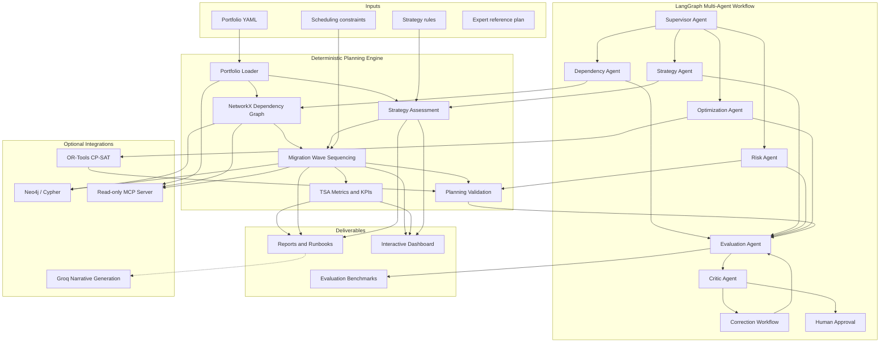

# Carve-out Copilot

> **Deterministic IT separation planner powered by dependency-graph analysis, multi-agent orchestration and constraint-based optimization.**
>
> Built for the *Nordia Retail* carve-out from Atlas Group — 30 assets, dependency-aware migration planning, TSA cost visibility, conflict detection and AI-assisted decision support.

[](https://www.python.org/)
[](LICENSE)
[](#5--pipeline-commands)
[](https://www.langchain.com/langgraph)
[](https://developers.google.com/optimization)

---

## Table of Contents

1. [What is this project?](#1--what-is-this-project)
2. [How it works](#2--how-it-works)
3. [Project structure](#3--project-structure)
4. [Installation](#4--installation)
5. [Pipeline commands](#5--pipeline-commands)
6. [Interactive Dashboard](#6--interactive-dashboard)
7. [Screenshots](#7--screenshots)
8. [Data model](#8--data-model)
9. [Configuration](#9--configuration)
10. [AI narrative generation](#10--ai-narrative-generation-optional)
11. [MCP server](#11--mcp-server-optional)
12. [Neo4j & Cypher graph analytics](#12--neo4j--cypher-graph-analytics)
13. [Agentic architecture and optimization](#13--agentic-architecture-and-optimization)
14. [Evaluation and human-in-the-loop](#14--evaluation-and-human-in-the-loop)
15. [Running tests](#15--running-tests)
16. [Contributing](#16--contributing--pushing-changes)
17. [License](#license)

---

## 1 · What is this project?

**Carve-out Copilot** is a Python toolkit designed to automate and support IT portfolio separation planning — the process required when a business unit is sold, spun off, or legally separated from its parent company.

The project uses a fictional enterprise scenario: **Nordia Retail**, a business being separated from **Atlas Group**.

An IT carve-out involves identifying which applications, databases and infrastructure components must be migrated, rebuilt, cloned, retired or temporarily retained through Transitional Service Agreements (TSAs).

Given a YAML description of:

- **Assets:** applications, databases and infrastructure.
- **Dependencies:** technical relationships between assets.
- **TSA services:** temporary services maintained by the parent company.
- **Licences:** software licences that may expire during the transition.
- **Planning constraints:** wave capacity, stabilisation gaps and freeze periods.
- **Strategy rules:** conditions used to determine the appropriate exit strategy.

The system computes a dependency-aware separation plan and provides reports, runbooks, an interactive dashboard and optional analytical integrations.

### Main capabilities

| Capability | Description |
|---|---|
| Dependency analysis | Direct and transitive dependencies, impact analysis and cycle detection |
| Migration planning | Deterministic, dependency-aware migration waves |
| Strategy assessment | Clone, Migrate, Rebuild, Retire and Retain-under-TSA |
| Conflict detection | TSA deadlines, licence expirations and circular dependencies |
| TSA cost estimation | Estimated service cost based on duration and monthly rates |
| Runbook generation | Markdown cutover guides for each migration wave |
| Interactive dashboard | Offline HTML dashboard with graph, Gantt and risk register |
| Multi-agent investigation | Specialized LangGraph agents using deterministic Python tools |
| Schedule optimization | OR-Tools CP-SAT scenario optimization |
| Workflow evaluation | Evidence checks, planning validation and critic decisions |
| Human approval | Interrupt-based human-in-the-loop workflow |
| Graph analytics | Optional Neo4j integration and named Cypher queries |
| MCP integration | Optional read-only Model Context Protocol server |

**Key design principle:** deterministic algorithms remain the source of truth for planning, scheduling, validation and financial calculations. LLMs help interpret requests and explain results, but do not override deterministic planning constraints.

---

## 2 · How it works

### 2.1 Deterministic planning pipeline

The original planning pipeline validates the portfolio, constructs the dependency graph, assigns strategies, schedules migration waves and calculates the resulting metrics.

```text
portfolio_v1.yaml
        |
        v
    loader.py
        |
        v
    graph.py
    NetworkX DiGraph
        |
        +----------------------+
        |                      |
        v                      v
  strategy.py            sequencing.py
  Rules-based             Dependency-aware
  assessment              wave computation
        |                      |
        +----------+-----------+
                   |
                   v
               metrics.py
             TSA costs / KPIs
                   |
          +--------+--------+
          |                 |
          v                 v
     documents.py       dashboard.py
     Jinja2 reports     Offline HTML
     and runbooks       visualizations
```

### 2.2 Overall system architecture

The planner separates deterministic computation, agent orchestration, evaluation and optional integrations.



### 2.3 Two complementary planning approaches

The project provides two distinct planning approaches.

| Approach | Purpose | Main technology |
|---|---|---|
| Deterministic planner | Establish a reproducible dependency-aware baseline | NetworkX and Python |
| Constraint optimizer | Explore alternative feasible migration schedules | OR-Tools CP-SAT |

The deterministic planner groups assets according to dependency ordering and planning rules.

The CP-SAT optimizer explores alternative assignments while enforcing modeled constraints, including dependency ordering, strongly connected component coupling, wave capacity and scenario delay requirements.

The two approaches are complementary. Their scheduling strategies differ, so their wave counts and estimated TSA costs can differ.

### 2.4 Why combine deterministic planning and agents?

A conventional planner computes a schedule but does not necessarily explain the consequences of a business question such as:

> What happens if we delay APP-06 by three months?

The agentic layer coordinates specialized investigations:

1. The Supervisor interprets the request.
2. The Dependency Agent investigates affected assets and dependencies.
3. The Strategy Agent retrieves deterministic strategy assessments.
4. The Risk Agent identifies relevant risks and conflicts.
5. The Optimization Agent evaluates alternative schedules when required.
6. The Evaluation Agent checks evidence and planning validity.
7. The Critic Agent determines whether the result is acceptable, needs correction or requires human review.
8. The approval workflow can pause for a human decision.

Agents call Python tools that use the existing planning engine. They do not replace the underlying algorithms.

---

## 3 · Project structure

```text
splitwise-it/
│
├── data/
│   ├── portfolio_v1.yaml
│   ├── portfolio_v2.yaml
│   ├── portfolio_v3.yaml
│   └── expert_plan_v1.yaml
│
├── config/
│   ├── strategy_rules.yaml
│   └── constraints.yaml
│
├── src/carveout/
│   ├── models.py
│   ├── loader.py
│   ├── graph.py
│   ├── strategy.py
│   ├── sequencing.py
│   ├── metrics.py
│   ├── sensitivity.py
│   ├── neo4j_store.py
│   ├── cypher_queries.py
│   ├── cli.py
│   ├── mcp_server.py
│   ├── config.py
│   │
│   ├── agents/
│   │   ├── supervisor.py
│   │   ├── dependency_agent.py
│   │   ├── strategy_agent.py
│   │   ├── risk_agent.py
│   │   ├── optimization_agent.py
│   │   ├── evaluation_agent.py
│   │   └── critic_agent.py
│   │
│   ├── tools/
│   │   ├── graph_tools.py
│   │   ├── planning_tools.py
│   │   ├── risk_tools.py
│   │   ├── strategy_tools.py
│   │   ├── optimization_tools.py
│   │   ├── neo4j_tools.py
│   │   └── correction_tools.py
│   │
│   ├── workflows/
│   │   ├── state.py
│   │   ├── routing.py
│   │   ├── approval.py
│   │   └── graph.py
│   │
│   ├── optimization/
│   │   ├── models.py
│   │   ├── solver.py
│   │   ├── validation.py
│   │   └── scenarios.py
│   │
│   ├── evaluation/
│   │   ├── metrics.py
│   │   └── benchmarks.py
│   │
│   └── generation/
│       ├── client.py
│       ├── documents.py
│       └── guardrails.py
│
├── templates/
│   ├── cutover_runbook.md.j2
│   └── separation_plan.md.j2
│
├── output/
│   ├── dashboard.html
│   ├── graph.html
│   ├── waves.json
│   ├── metrics.json
│   ├── strategy_assessment.json
│   ├── dependency_graph.json
│   ├── graph.cypher
│   └── runbooks/
│
├── evaluation/
│
├── tests/
│   ├── test_loader.py
│   ├── test_planning.py
│   ├── test_sensitivity.py
│   ├── test_generation.py
│   ├── test_mcp_server.py
│   ├── test_tools.py
│   ├── test_agents.py
│   ├── test_optimization.py
│   ├── test_evaluation.py
│   ├── test_critic.py
│   ├── test_correction_loop.py
│   └── test_human_approval.py
│
├── schema/
│   └── portfolio.schema.json
│
├── docs/
│   ├── architecture.md
│   └── screenshots/
│
├── pyproject.toml
├── README.md
└── LICENSE
```

*The structure describes the principal project modules. Optional integrations and generated files depend on installed extras and executed commands.*

---

## 4 · Installation

### Requirements

- Python 3.11 or newer
- Git
- Windows, Linux or macOS

### Clone the repository

```powershell
git clone https://github.com/maryem37/splitwise-it.git
cd splitwise-it
```

### Create a virtual environment

```powershell
py -m venv .venv
.venv\Scripts\Activate.ps1
```

If PowerShell blocks activation scripts:

```powershell
Set-ExecutionPolicy -Scope
