# Carve-out Copilot

> **Enterprise IT Separation & Decision Intelligence Platform** — combining **Dependency-Graph Analysis (NetworkX)**, **Constraint Optimization (Google OR-Tools CP-SAT)**, **Multi-Agent Orchestration (LangGraph)**, and **Human-in-the-Loop Governance** in a single unified FastAPI web platform.

[](https://www.python.org/)
[](#13--testing--quality-assurance)
[](https://developers.google.com/optimization)
[](https://www.langchain.com/langgraph)
[](https://fastapi.tiangolo.com/)
[](#11--docker-deployment)
[](LICENSE)

---

## Executive Summary (For Recruiters & Hiring Managers)

### The Business Problem
When a company sells or spins off a business unit (an **IT Carve-out**, such as *Nordia Retail* separating from *Atlas Group*), IT teams must migrate dozens of interdependent applications, databases, and servers off parent-company infrastructure before **Transitional Service Agreements (TSAs)** and software licences expire. Moving one system out of order breaks downstream applications; moving too slowly costs hundreds of thousands of dollars in TSA fees.

### What Carve-out Copilot Delivers
Carve-out Copilot automates separation planning and turns complex dependency graphs into an **auditable, cost-optimized migration roadmap**:

- **Deterministic Baseline:** Computes a dependency-aware **6-wave plan** across **30 IT assets**, automatically flagging circular dependencies (`APP-06 ↔ APP-07`) and **2 critical schedule conflicts** (`APP-08` licence expiry, `APP-01` TSA overrun) at **\$1.93M** estimated TSA cost.
- **Mathematical Cost Optimization (OR-Tools CP-SAT):** Re-sequences migrations into **5 waves**, reducing TSA exposure to **\$1.64M** (**\$290,000 net savings**) and cutting conflicts in half while respecting every dependency and capacity constraint.
- **Multi-Agent AI with Guardrails (LangGraph):** 7 specialized agents (Supervisor, Dependency, Strategy, Risk, Optimization, Evaluation, Critic) investigate "what-if" questions (e.g., *"What happens if we delay APP-06 by 12 weeks?"*), run bounded self-correction loops, and **pause for Human-in-the-Loop approval** persisted in SQLite.
- **Strict Separation of Fact & AI:** Deterministic algorithms and CP-SAT remain the single source of truth. LLMs only synthesize narratives and never override hard constraints or financial math.
- **Production-Ready Engineering:** Unified FastAPI Web Platform, REST API with OpenAPI docs, constant-time approval token auth (`hmac.compare_digest`), non-root Docker setup, structured JSON logging, and **102 automated tests (0 failures)**.

---

## Tech Stack & Tools Used

| Category | Tools & Libraries | Role in Project |
|---|---|---|
| **Language & Runtime** | Python 3.11+, Setuptools | Core application runtime and packaging (`pyproject.toml`) |
| **Graph & Planning** | `NetworkX` (>=3.2), `PyYAML` (>=6.0), `Pydantic` (>=2.5) | Dependency graph, Tarjan SCC cycle detection, topological wave sequencing, YAML schema validation |
| **Constraint Optimization** | `Google OR-Tools` CP-SAT (>=9.8) | Integer programming solver minimizing TSA cost & duration under dependency/capacity constraints |
| **Multi-Agent AI** | `LangGraph` (>=0.2.0), `LangChain Core` (>=0.3.0), `langgraph-checkpoint-sqlite` (>=3.0.0) | 7-agent orchestration, bounded correction loops, and `interrupt()` Human-in-the-Loop workflows |
| **LLM Integration (Optional)** | `Groq` API (`groq>=0.11`, `langchain-groq>=0.2.0`), `python-dotenv` | Optional narrative synthesis for runbooks and executive summaries |
| **Web Backend & API** | `FastAPI` (>=0.110), `Uvicorn` (>=0.27), `HTTPX` (>=0.27) | REST API, OpenAPI/Swagger docs, lifespan health/readiness probes, and unified 6-tab Web UI |
| **Persistence & Security** | `SQLite` (WAL mode), `hmac.compare_digest` | Cross-process workflow checkpointing, constant-time approval token verification, path-traversal protection |
| **Reporting & Visualization** | `Jinja2` (>=3.1), HTML5/CSS/JS, SVG Charts, `vis-network` | Offline interactive dashboard, Gantt calendar, force-directed graph, Markdown/JSON reports & cutover runbooks |
| **Integrations (Optional)** | `MCP` (`mcp>=1.9,<2`), `Neo4j` driver (`neo4j>=5.0`) | Read-only Model Context Protocol server (`stdio`) and Neo4j/Cypher graph analytics (12 named queries) |
| **DevOps & Testing** | `Docker`, `Docker Compose`, `pytest` (>=8.0) | Multi-stage non-root containerization with persistent volumes and 102 automated tests |

---

## Table of Contents

1. [Input → Engine → Output](#1--input--engine--output)
2. [Unified Platform Tour & Screenshots](#2--unified-platform-tour--screenshots)
3. [Quick Start (60 Seconds)](#3--quick-start-60-seconds)
4. [System Architecture](#4--system-architecture)
5. [Multi-Agent & Human-in-the-Loop Workflow](#5--multi-agent--human-in-the-loop-workflow)
6. [Decision Intelligence & Explainability](#6--decision-intelligence--explainability)
7. [CLI Command Reference](#7--cli-command-reference)
8. [REST API Reference](#8--rest-api-reference)
9. [Optional Integrations (Groq AI, MCP, Neo4j)](#9--optional-integrations-groq-ai-mcp-neo4j)
10. [Configuration & Environment Variables](#10--configuration--environment-variables)
11. [Docker Deployment](#11--docker-deployment)
12. [Security Scope](#12--security-scope)
13. [Testing & Quality Assurance](#13--testing--quality-assurance)
14. [Project Structure](#14--project-structure)
15. [Known Limitations](#15--known-limitations)

---

## 1 · Input → Engine → Output

| Stage | What goes in / happens / comes out |
|---|---|
| **INPUT** | **Portfolio YAML** (`data/portfolio_v1.yaml`): 30 assets (apps, datastores, infrastructure), dependency edges (`CALLS`, `READS_FROM`, `HOSTED_ON`, etc.), TSA contracts with monthly costs, and software licences.<br>**Rules & Constraints** (`config/strategy_rules.yaml`, `config/constraints.yaml`): exit strategy rules, max 8 assets/wave, 2-week stabilization gaps. |
| **ENGINE** | **1. Deterministic Core (NetworkX):** Topological wave sequencing, strongly connected component (SCC) cycle detection, conflict & risk register.<br>**2. Constraint Solver (OR-Tools CP-SAT):** Discrete integer programming (`num_search_workers=1`, `random_seed=42` for reproducibility) minimizing TSA cost or duration.<br>**3. Agentic Layer (LangGraph + SQLite):** Multi-agent investigation, Evaluation & Critic verification, bounded correction loop, and `interrupt()`-based Human-in-the-Loop approval. |
| **OUTPUT** | **Unified Web Platform** (`http://127.0.0.1:8000`): Interactive Dependency Graph, Gantt Calendar, Conflict & Risk Register, TSA Cost Charts, What-If Simulator, Human Approval Console, and Markdown/JSON Executive Audit Reports.<br>**Offline Deliverables** (`output/`): Standalone `dashboard.html`, `graph.html`, wave cutover runbooks, and `separation_plan.md`. |

---

## 2 · Unified Platform Tour & Screenshots

All capabilities are unified inside a single FastAPI web platform (`http://127.0.0.1:8000`) with 6 tabs:

### Tab 1 · Visual Dashboard (Dependency Graph, Gantt, Risks & TSA Costs)

#### Dependency Graph across 6 Migration Waves
> All 30 assets arranged by topological wave (`Wave 1` to `Wave 6`). Color-coded by exit strategy (`Clone`, `Migrate`, `Rebuild`, `Retire`, `Retain under TSA`), with red outlines for active conflicts and amber outlines for the `APP-06 ↔ APP-07` circular dependency.

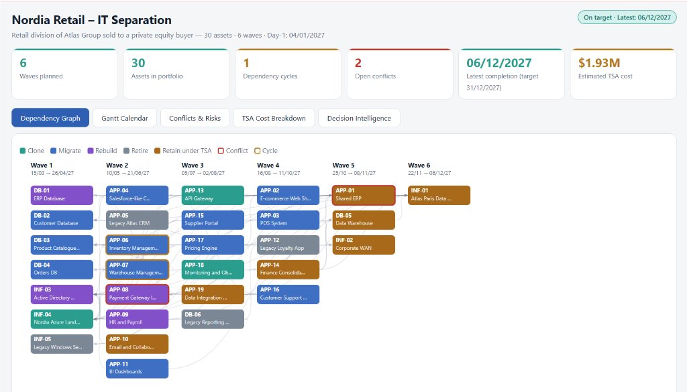

#### Interactive Node Inspection — Licence Conflict (`APP-08`)
> Clicking `APP-08` highlights upstream prerequisites (`APP-01`, `INF-04`), downstream dependants (`APP-02`, `APP-03`), and the active `licence_expires_before_cutover: 2027-04-30` conflict.

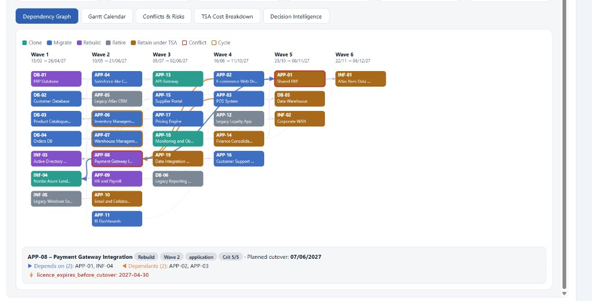

#### Interactive Node Inspection — Circular Dependency (`APP-06 ↔ APP-07`)
> Clicking `APP-06` highlights its 4 prerequisites and bidirectional circular coupling with `APP-07` in Wave 2.

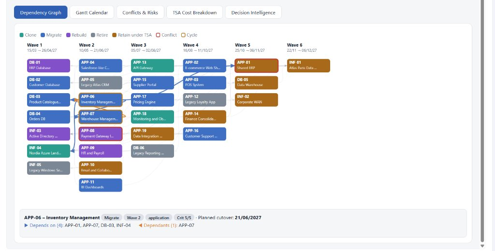

#### Gantt Calendar Timeline
> Wave execution windows across 2027 against the `31/12/2027` target TSA exit deadline.

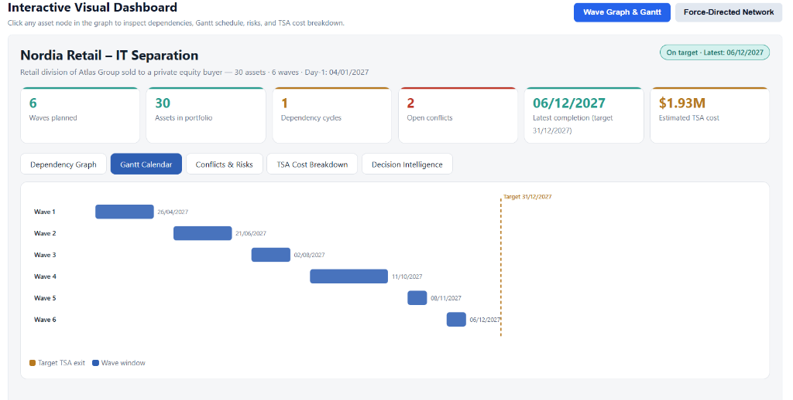

#### Conflicts & Risk Register
> Automatic detection of `APP-08` licence expiry (`LIC-04`) and `APP-01` TSA overrun (`TSA-01`), alongside the 13-item risk register with likelihood, impact, and owners.

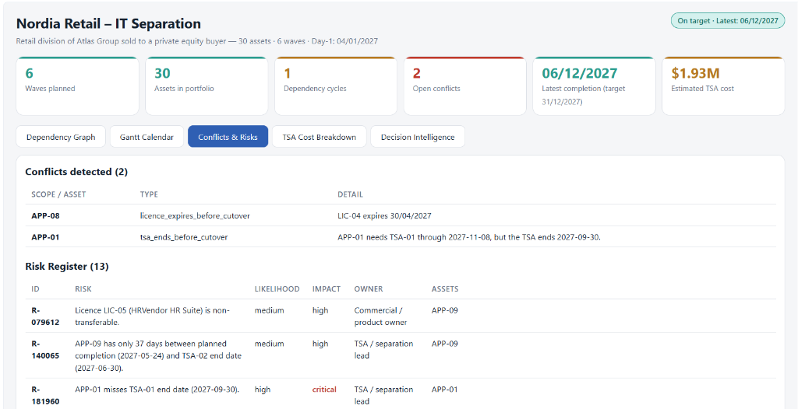

#### TSA Cost Breakdown
> Per-contract TSA cost exposure (`$1.93M` total across `TSA-01` to `TSA-04`) with contracted end dates and required duration in months.

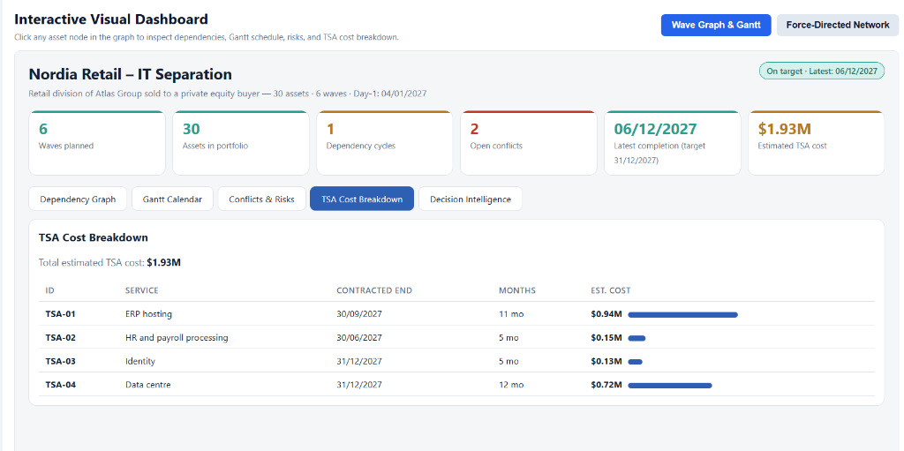

#### Embedded Decision Intelligence Comparison
> Side-by-side comparison of Deterministic Baseline vs CP-SAT Optimized plan inside the visual dashboard.

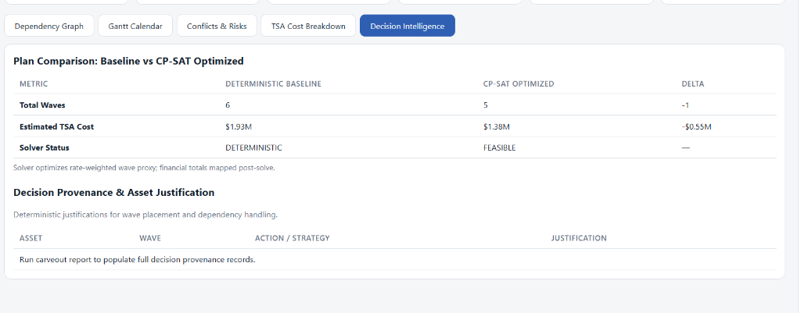

---

### Tab 2 · Input & Output Data

> Clean executive summary of the loaded YAML portfolio: KPI cards, circular dependency & conflict alerts, and the computed migration waves table.

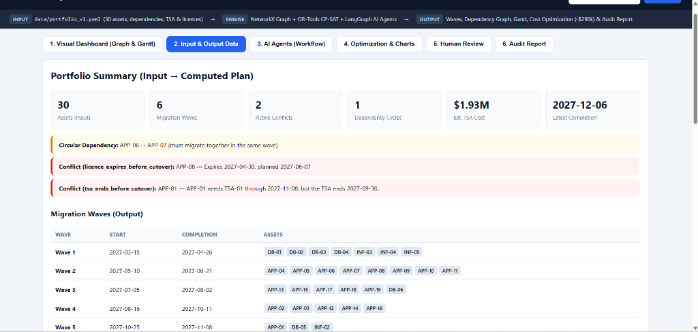

---

### Tab 3 · AI Agents (LangGraph Workflow & Telemetry)

> Launching a multi-agent investigation (`Investigate APP-06 delay and optimize`). The Evaluation Agent returns `PASS_WITH_WARNINGS`, the Critic Agent issues `HUMAN_REVIEW_REQUIRED`, and the workflow pauses safely in SQLite (`Status: interrupted`).

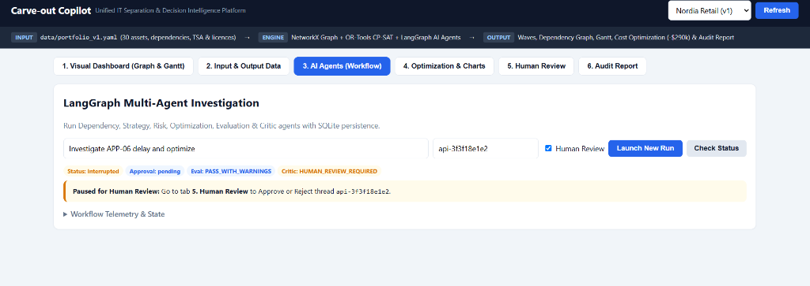

> Full execution telemetry and state persisted in SQLite (`optimization_status: OPTIMAL`, `total_duration_seconds: 8.275`).

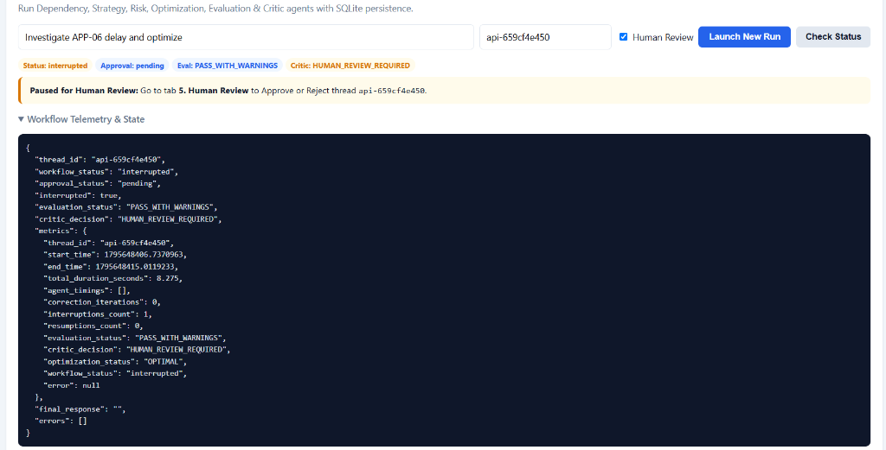

---

### Tab 4 · Optimization, Explainability & What-If Charts

#### Per-Asset Wave Explanation (`APP-06`)
> Traces exact placement rationale, circular coupling (`APP-06 ↔ APP-07`), blocking dependencies (`APP-01`, `DB-03`, `INF-04`), and consequences of moving earlier or later.

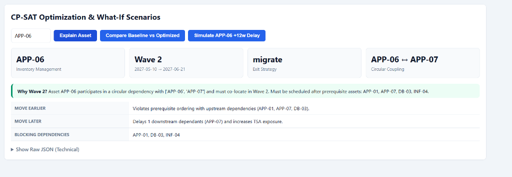

#### Baseline vs CP-SAT Optimization (`-$290k` Savings)
> Visual bar chart and asset reallocation table showing how OR-Tools CP-SAT reduces waves from `6` to `5`, conflicts from `2` to `1`, and TSA cost from `$1.93M` to `$1.64M` (`-$290k` savings).

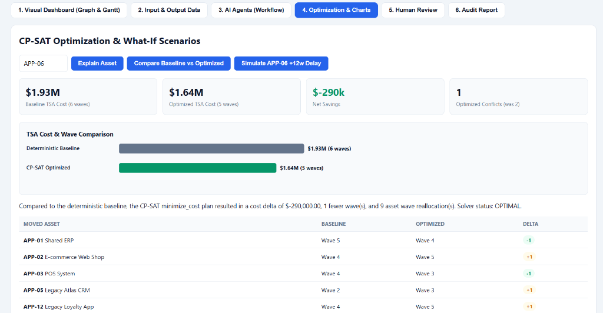

#### Isolated What-If Delay Scenario (`APP-06 +12w Delay`)
> Memory-isolated simulation showing that a 12-week delay on `APP-06` (automatically propagating to coupled `APP-07`) increases TSA cost by `+$145k` (`$1.64M → $1.78M`) and pushes completion to `2027-12-27` without mutating source YAML files.

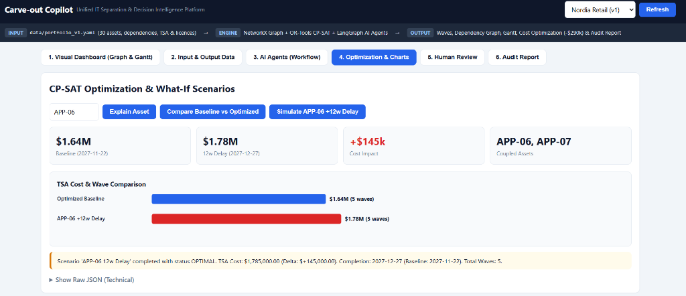

---

### Tab 5 · Human-in-the-Loop Approval

> Resuming the paused SQLite thread (`APPROVE` / `REJECT`). Once approved, the workflow completes and outputs the full multi-agent executive investigation report.

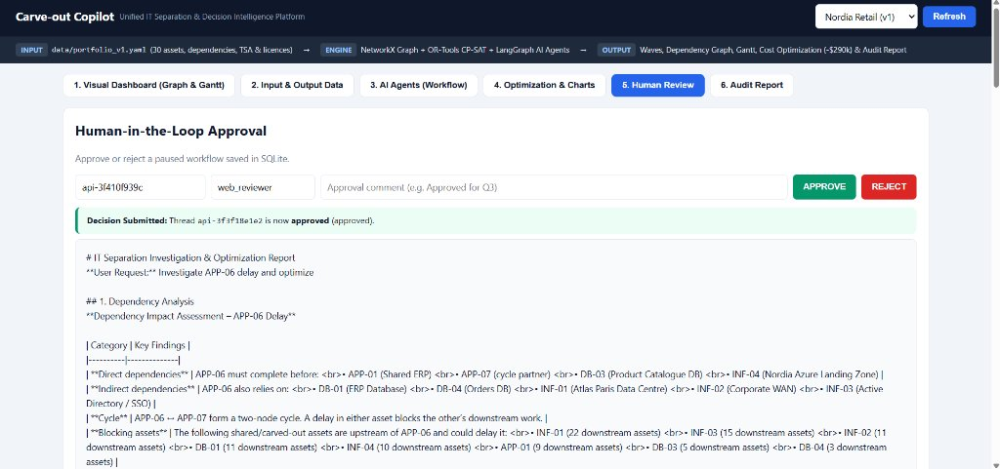

---

### Tab 6 · Executive Decision & Audit Report

> One-click generation of audit-ready Markdown or JSON decision reports (`RPT-...`) combining plan comparisons, per-asset provenance records, and evaluation status.

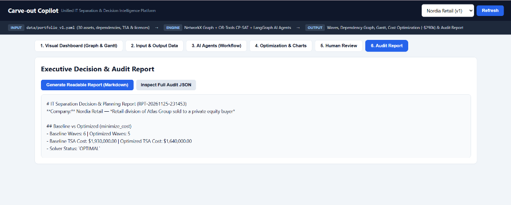

---

## 3 · Quick Start (60 Seconds)

### Prerequisites
- Python **3.11+**
- Git (Windows, Linux, or macOS)

### 1. Clone & Install

```powershell
git clone https://github.com/maryem37/splitwise-it.git
cd splitwise-it

py -m venv .venv
.venv\Scripts\Activate.ps1

# Install all extras (deterministic core + LangGraph agents + OR-Tools + FastAPI)
pip install -e ".[agents,optimization,api]"
```

### 2. Generate Outputs & Launch the Unified Platform

```powershell
# Run deterministic pipeline (generates output/dashboard.html, graph.html, runbooks)
carveout run-all

# Start the unified FastAPI web platform
uvicorn carveout.api.app:app --host 127.0.0.1 --port 8000
```

Open **`http://127.0.0.1:8000`** in your browser (or **`http://127.0.0.1:8000/docs`** for Swagger OpenAPI documentation).

> If port `8000` is already in use, run on `--port 8001` and open `http://127.0.0.1:8001`.

---

## 4 · System Architecture

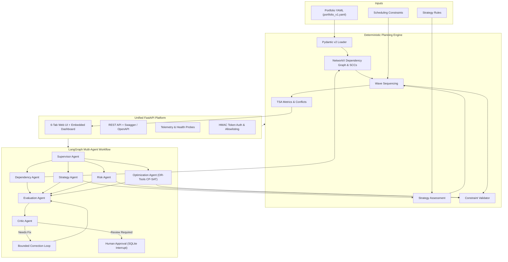

### Layer-by-Layer Architectural Breakdown

#### Layer 1 · Data Model & Deterministic Planning Core (`src/carveout/`)
| Module | Responsibility | Key Mechanism |
|---|---|---|
| `models.py` & `loader.py` | Schema validation & ingestion | **Pydantic v2** strict models (`Portfolio`, `Asset`, `Relationship`, `Licence`, `TSAService`) with JSON Schema export (`schema/portfolio.schema.json`). |
| `graph.py` | Dependency graph & cycles | **NetworkX DiGraph**; detects Strongly Connected Components (SCCs) such as `APP-06 ↔ APP-07` and computes transitive prerequisites/impact. |
| `strategy.py` | Exit strategy assignment | Ordered first-match rule engine (`config/strategy_rules.yaml`) assigning `clone`, `migrate`, `rebuild`, `retire`, or `retain_under_tsa`. |
| `sequencing.py` | Wave scheduling & conflicts | Condenses SCCs into a DAG, runs topological wave grouping respecting `max_assets_per_wave`, `weeks_per_wave_gap`, and `freeze_periods`, and flags licence/TSA deadline overruns. |
| `metrics.py` & `sensitivity.py` | Financial KPIs & risk | Computes per-TSA duration in months, total TSA cost exposure, critical path, and Monte Carlo delay sensitivity. |

#### Layer 2 · Constraint Optimization Engine (`src/carveout/optimization/`)
| Component | Detail |
|---|---|
| **Solver** (`solver.py`) | **Google OR-Tools CP-SAT** integer programming over discrete wave variables `wave[u] ∈ [1..max_waves]`. Configured with `num_search_workers=1` and `random_seed=42` for **100% reproducible results**. |
| **Hard Constraints** | Dependency precedence (`wave[dep] <= wave[asset]`), reversed exit order for `retain_under_tsa` parent assets, SCC co-location (`wave[APP-06] == wave[APP-07]`), per-wave capacity (`<= 8` assets), and scenario delay floors. |
| **Objectives** | `minimize_cost` (rate-weighted wave proxy prioritizing early TSA exit), `minimize_duration` (minimizes total waves), and `balanced`. |
| **Validation** (`validation.py`) | Independent post-solve verification confirming zero constraint violations before any schedule is accepted. |

#### Layer 3 · LangGraph Multi-Agent Orchestration (`src/carveout/agents/`, `workflows/`)
| Component | Detail |
|---|---|
| **State & Routing** (`state.py`, `routing.py`) | Typed `CarveoutState` tracks user request, tool evidence, optimization results, evaluation report, critic decision, correction attempts, node timings, and errors. |
| **7 Specialized Agents** | `Supervisor` (intent + synthesis) → `Dependency`, `Strategy`, `Risk`, `Optimization` (deterministic tools + CP-SAT) → `Evaluation` (constraint & evidence audit) → `Critic` (deterministic gatekeeper). |
| **Bounded Correction Loop** (`correction_tools.py`) | Explicit LangGraph cycle (`critic_node → correction_node → evaluation_node`) capped at `max_correction_attempts` (default `2`, max `3`) with **signature deduplication** to prevent infinite loops. |
| **SQLite Persistence & HITL** (`checkpointer.py`, `approval.py`) | SQLite in **WAL mode** (`PRAGMA busy_timeout = 15000`, `isolation_level=None`) stores checkpoints keyed by `thread_id`. LangGraph `interrupt()` pauses execution for `APPROVE` / `REJECT` / `REQUEST_REVISION` across separate processes or server restarts. |

#### Layer 4 · Decision Intelligence & Explainability (`src/carveout/`)
- **Strict Fact vs AI Separation (`decision_provenance.py`):** Every decision emits a `DecisionProvenanceRecord` separating `deterministic_facts` (graph edges, wave bounds, constraints) from `narrative_explanation`. LLMs can never override deterministic results.
- **Asset Explainability (`explain.py`):** Computes per-asset wave justification, blocking dependencies, SCC membership, and `move_earlier` / `move_later` consequences.
- **Plan Comparison & Isolated Scenarios (`comparison.py`, `scenarios_manager.py`):** Compares Baseline vs CP-SAT (`-$290k` savings) and simulates delays/rate multipliers on deep-copied in-memory models so source YAML files remain immutable.

#### Layer 5 · Unified FastAPI Platform, Security & Observability (`src/carveout/api/`, `logging_config.py`)
- **Unified Web UI (`ui.py`, `app.py`):** Serves the 6-tab platform at `/`, embeds the interactive visual dashboard at `/dashboard`, and exposes force-directed graphs at `/graph`.
- **Operational Probes & Telemetry (`telemetry.py`):** `/api/health` (liveness), `/api/ready` (verifies SQLite + portfolio files), `/api/metrics` (request latency, status counts, workflow outcomes), and structured JSON logging (`CARVEOUT_LOG_JSON=true`).
- **Security Controls (`security.py`):** Constant-time `hmac.compare_digest` verification for `CARVEOUT_APPROVAL_TOKEN`, strict portfolio ID allowlisting (blocks path traversal), and lifespan startup config validation.

---

## 5 · Multi-Agent & Human-in-the-Loop Workflow

- **Supervisor Agent (`src/carveout/agents/supervisor.py`):** Classifies business intent, routes across specialized agents, and synthesizes grounded findings. Works fully offline; enhances prose when `GROQ_API_KEY` is configured.
- **Dependency, Strategy, Risk & Optimization Agents (`src/carveout/agents/`):** Execute deterministic Python tools and Google OR-Tools CP-SAT (`num_search_workers=1`, `random_seed=42`) to analyze dependencies, exit strategies (`clone`, `migrate`, `rebuild`, `retire`, `retain_under_tsa`), conflicts, and optimal wave schedules.
- **Evaluation Agent (`src/carveout/agents/evaluation_agent.py`):** Independently verifies evidence completeness, hard constraint satisfaction, and financial consistency (`PASS`, `PASS_WITH_WARNINGS`, `FAIL`, `INCOMPLETE`).
- **Critic Agent & Bounded Correction Loop (`src/carveout/agents/critic_agent.py`, `src/carveout/tools/correction_tools.py`):** Applies deterministic rules (`ACCEPTED`, `CORRECTION_REQUIRED`, `HUMAN_REVIEW_REQUIRED`, `BLOCKED`) with a bounded cycle (`critic → correction → evaluation`, max 2–3 attempts, duplicate-signature prevention).
- **Cross-Process SQLite Persistence (`src/carveout/workflows/checkpointer.py`):** Uses SQLite in WAL mode (`.carveout/checkpoints.sqlite`) so workflows paused at `interrupt()` can be inspected and resumed from any process or after server restarts.

---

## 6 · Decision Intelligence & Explainability

- **Decision Provenance (`src/carveout/decision_provenance.py`):** Records `DecisionProvenanceRecord` entries linking every wave assignment to supporting graph edges, active constraints, source YAML references, and deterministic facts — kept strictly separate from LLM prose.
- **Asset Explainability (`src/carveout/explain.py`):** Explains why an asset is in its wave, its upstream/downstream chains, SCC coupling, and consequences of moving earlier or later.
- **Plan Comparison (`src/carveout/comparison.py`):** Reconciles wave counts, completion dates, TSA cost deltas, and per-asset shifts between Deterministic Baseline and CP-SAT scenarios.
- **Isolated What-If Scenarios (`src/carveout/scenarios_manager.py`):** Simulates cutover delays and TSA rate multipliers on an in-memory copy — **source YAML files are never mutated**.
- **Decision Reports (`src/carveout/decision_report.py`):** Exports audit-ready Markdown and JSON packages.

---

## 7 · CLI Command Reference

```powershell
# ── Deterministic Pipeline ───────────────────────────────────────────────
carveout validate                 # Validate portfolio YAML schema
carveout graph                    # Build dependency graph -> dependency_graph.json + graph.html
carveout strategy                 # Assign exit strategies -> strategy_assessment.json
carveout waves                    # Compute waves & conflicts -> waves.json + metrics.json
carveout generate                 # Generate Markdown runbooks & separation plan
carveout evaluate                 # Benchmark against reference expert plan
carveout run-all                  # Run full deterministic pipeline + dashboard.html
carveout run-all --ai             # Include Groq LLM narrative (optional)

# ── Optimization & Agentic Workflows ─────────────────────────────────────
carveout optimize --scenario minimize_cost --objective minimize_cost
carveout agent "What happens if we delay APP-06 by three months?"
carveout agent --human-review --thread-id review-01 "Optimize schedule to minimize cost"
carveout agent-status --thread-id review-01
carveout agent-resume --thread-id review-01 --action APPROVE --comment "Approved by PMO"

# ── Decision Intelligence (Phase 4) ──────────────────────────────────────
carveout explain APP-06
carveout compare --scenario minimize_cost
carveout scenario --delay-asset APP-06 --delay-weeks 8 --rate-multiplier 1.2
carveout report --format markdown --report-output output/decision_report.md
```

---

## 8 · REST API Reference

| Method | Endpoint | Auth | Description |
|---|---|---|---|
| `GET` | `/` | Public | Unified 6-tab Web UI |
| `GET` | `/dashboard` | Public | Embedded interactive visual dashboard (Graph, Gantt, Risks, TSA) |
| `GET` | `/graph` | Public | Force-directed network graph (`output/graph.html`) |
| `GET` | `/docs` | Public | Swagger UI (OpenAPI) |
| `GET` | `/api/health` | Public | Liveness probe (`{"status": "ok"}`) |
| `GET` | `/api/ready` | Public | Readiness probe (verifies SQLite + portfolio availability) |
| `GET` | `/api/metrics` | Public | In-process HTTP & workflow telemetry |
| `GET` | `/api/portfolios` | Public | List allowlisted portfolios |
| `GET` | `/api/portfolios/{id}` | Public | Portfolio details, waves, conflicts, and TSA cost |
| `POST` | `/api/workflows` | Public | Launch LangGraph workflow (`409` on duplicate `thread_id`) |
| `GET` | `/api/workflows/{thread_id}` | Public | Full workflow state and narrative |
| `GET` | `/api/workflows/{thread_id}/status` | Public | Compact status + interrupt payload |
| `POST` | `/api/workflows/{thread_id}/resume` | **Token** | Resume paused workflow (`APPROVE` / `REJECT` / `REQUEST_REVISION`) |
| `GET` | `/api/assets/{asset_id}/explanation` | Public | Per-asset wave explanation and provenance |
| `GET` | `/api/comparisons` | Public | Baseline vs CP-SAT comparison |
| `POST` | `/api/scenarios` | Public | Execute isolated what-if scenario |
| `GET` | `/api/reports/{portfolio_id}` | Public | Generate decision report (`format=markdown\|json`) |

---

## 9 · Optional Integrations (Groq AI, MCP, Neo4j)

- **Groq AI Narrative (`pip install -e ".[ai]"`):** Set `GROQ_API_KEY` in `.env` and run `carveout run-all --ai` for LLM-written executive summaries.
- **Read-Only MCP Server (`carveout-mcp`):** Exposes `portfolio_summary`, `list_assets`, `asset_dependencies`, and `compute_plan` over local `stdio` transport for IDE/agent integrations without write access.
- **Neo4j & Cypher (`carveout neo4j-export` / `neo4j-load` / `neo4j-query`):** Exports `:Asset`, `:TSAService`, and `:Licence` nodes and includes 12 named Cypher analytics queries (`transitive_impact`, `tsa_conflicts`, `critical_path`, `cycles`, `shared_blockers`, etc.).

---

## 10 · Configuration & Environment Variables

Copy `.env.example` to `.env` to customize settings:

| Variable | Default | Description |
|---|---|---|
| `CARVEOUT_CHECKPOINT_DB` | `.carveout/checkpoints.sqlite` | SQLite checkpoint persistence path |
| `CARVEOUT_APPROVAL_TOKEN` | *(unset)* | Required `X-Approval-Token` header for `/resume` when set |
| `CARVEOUT_CORS_ORIGINS` | `http://localhost:8000,http://127.0.0.1:8000` | Comma-separated allowed CORS origins |
| `CARVEOUT_LOG_LEVEL` | `INFO` | Logging level (`DEBUG`, `INFO`, `WARNING`, `ERROR`) |
| `CARVEOUT_LOG_JSON` | `false` | `true` for structured JSON logs |
| `GROQ_API_KEY` | *(unset)* | Optional Groq API key for LLM narrative synthesis |
| `CARVEOUT_API_HOST` | `0.0.0.0` | Uvicorn bind host |
| `CARVEOUT_API_PORT` | `8000` | Uvicorn bind port |

---

## 11 · Docker Deployment

```powershell
# Build and start in detached mode
docker compose up --build -d

# Check logs and health
docker compose logs -f carveout
Invoke-RestMethod http://localhost:8000/api/ready

# Stop (preserves SQLite checkpoint volume)
docker compose down
```

- Runs as non-root user `carveout` (UID 1000).
- Persists SQLite checkpoints in named volume `carveout_checkpoints` (`/app/.carveout/checkpoints.sqlite`).
- Configured with `GET /api/health` Docker healthcheck and graceful SIGTERM shutdown.

---

## 12 · Security Scope

- **Constant-Time Token Auth:** `POST /api/workflows/{thread_id}/resume` validates `X-Approval-Token` using `hmac.compare_digest` whenever `CARVEOUT_APPROVAL_TOKEN` is configured.
- **Portfolio Allowlisting & Path Traversal Protection:** Only allowlisted portfolio IDs (`portfolio_v1`, `portfolio_v2`, `portfolio_v3`) are accepted by the API; path traversal attempts return `404`.
- **Startup Config Validation:** Lifespan startup logs warnings if `CARVEOUT_APPROVAL_TOKEN` is unset or `CARVEOUT_CORS_ORIGINS=*`.

---

## 13 · Testing & Quality Assurance

```powershell
.venv\Scripts\Activate.ps1
pytest -v
```

**Latest run: `102 passed, 0 failed`** across 21 test suites covering:
- Portfolio YAML loading & schema validation (`test_loader.py`)
- Wave sequencing, strategy rules & conflict detection (`test_planning.py`)
- Sensitivity & Monte Carlo analysis (`test_sensitivity.py`)
- Document generation & guardrails (`test_generation.py`)
- Read-only MCP server (`test_mcp_server.py`)
- Deterministic agent tools & LangGraph multi-agent routing (`test_tools.py`, `test_agents.py`)
- OR-Tools CP-SAT solver, SCC coupling & scenario immutability (`test_optimization.py`)
- Evaluation benchmarks, Critic policy & bounded correction loop (`test_evaluation.py`, `test_critic.py`, `test_correction_loop.py`)
- Human-in-the-loop `interrupt()`, SQLite persistence & cross-process resumption (`test_human_approval.py`, `test_checkpoint_persistence.py`, `test_cross_process_resume.py`, `test_workflow_reliability.py`)
- Structured logging, WAL mode & operational reliability (`test_observability.py`, `test_operational_reliability.py`)
- Decision provenance, explainability, comparisons, scenarios & reports (`test_decision_intelligence.py`, `test_scenarios_and_reporting.py`)
- FastAPI endpoints, approval auth, restart recovery, readiness & telemetry (`test_api_and_e2e.py`, `test_phase6_operational.py`)

---

## 14 · Project Structure

```text
splitwise-it/
├── data/                        # Sample portfolios (portfolio_v1/v2/v3.yaml, expert_plan_v1.yaml)
├── config/                      # strategy_rules.yaml, constraints.yaml
├── src/carveout/
│   ├── models.py, loader.py     # Pydantic v2 schema & YAML loader
│   ├── graph.py, strategy.py    # NetworkX graph & rule-based strategy engine
│   ├── sequencing.py, metrics.py# Wave computation, conflicts & TSA cost metrics
│   ├── explain.py, comparison.py# Asset explainability & baseline vs CP-SAT comparison
│   ├── decision_provenance.py   # Structured provenance records
│   ├── scenarios_manager.py     # Isolated what-if scenario engine
│   ├── decision_report.py       # Markdown & JSON audit reports
│   ├── dashboard.py             # Self-contained HTML dashboard generator
│   ├── cli.py, mcp_server.py    # CLI & read-only MCP server
│   ├── agents/                  # 7 LangGraph agents (Supervisor -> Critic)
│   ├── tools/                   # Deterministic tool wrappers for agents
│   ├── workflows/               # LangGraph state, routing, approval, SQLite checkpointer
│   ├── optimization/            # OR-Tools CP-SAT solver & constraint validation
│   ├── evaluation/              # Benchmarks & evaluation metrics
│   ├── generation/              # Jinja2 templates & optional Groq narrative
│   └── api/                     # FastAPI app, unified Web UI, schemas, security, telemetry
├── templates/                   # Cutover runbook & separation plan Jinja2 templates
├── docs/screenshots/            # 13 screenshots of the unified platform
├── tests/                       # 21 test modules (102 tests passing)
├── Dockerfile, docker-compose.yml, .env.example, pyproject.toml
└── README.md
```

---

## 15 · Known Limitations

- **Docker Live Container Validation:** Docker configuration and non-root setup were audited, while live container build/execution requires a running Docker Desktop Linux daemon.
- **Solver Determinism vs Speed:** CP-SAT runs with `num_search_workers=1` and `random_seed=42` to ensure deterministic, reproducible wave assignments across runs.
- **SQLite Concurrency:** SQLite with WAL mode is ideal for single-instance deployments; multi-instance horizontal scaling would require a PostgreSQL checkpointer.
- **Freeze Periods:** Freeze periods in `constraints.yaml` are enforced during calendar sequencing (`sequencing.py`) and post-solve calendar mapping rather than inside the discrete CP-SAT integer model.

---

## License

[MIT](LICENSE) — Maryem, 2026.
