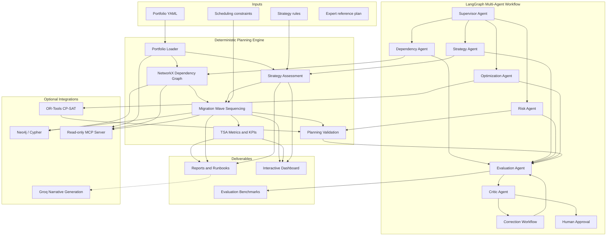
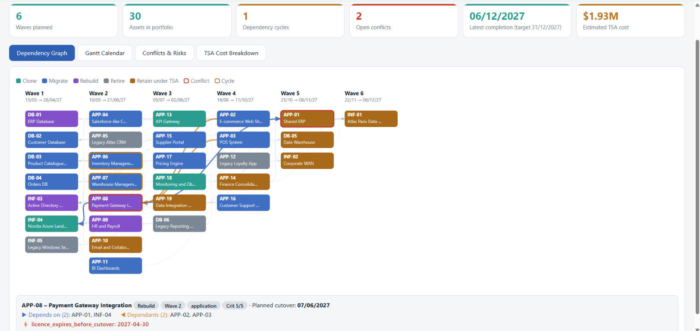

# Carve-out Copilot

> **Deterministic IT separation planner powered by dependency-graph analysis, multi-agent orchestration and constraint-based optimization.**
>
> Built for the *Nordia Retail* carve-out from Atlas Group — 30 assets, dependency-aware migration planning, TSA cost visibility, conflict detection and AI-assisted decision support.

[](https://www.python.org/)
[](LICENSE)
[](#5--pipeline-commands)
[](https://www.langchain.com/langgraph)
[](https://developers.google.com/optimization)

---

## Table of Contents

1. [What is this project?](#1--what-is-this-project)
2. [How it works](#2--how-it-works)
3. [Project structure](#3--project-structure)
4. [Installation](#4--installation)
5. [Pipeline commands](#5--pipeline-commands)
6. [Interactive Dashboard](#6--interactive-dashboard)
7. [Screenshots](#7--screenshots)
8. [Data model](#8--data-model)
9. [Configuration](#9--configuration)
10. [AI narrative generation](#10--ai-narrative-generation-optional)
11. [MCP server](#11--mcp-server-optional)
12. [Neo4j & Cypher graph analytics](#12--neo4j--cypher-graph-analytics)
13. [Agentic architecture and optimization](#13--agentic-architecture-and-optimization)
14. [Evaluation and human-in-the-loop](#14--evaluation-and-human-in-the-loop)
15. [Running tests](#15--running-tests)
16. [Contributing](#16--contributing--pushing-changes)
17. [License](#license)

---

## 1 · What is this project?

**Carve-out Copilot** is a Python toolkit designed to automate and support IT portfolio separation planning — the process required when a business unit is sold, spun off, or legally separated from its parent company.

The project uses a fictional enterprise scenario: **Nordia Retail**, a business being separated from **Atlas Group**.

An IT carve-out involves identifying which applications, databases and infrastructure components must be migrated, rebuilt, cloned, retired or temporarily retained through Transitional Service Agreements (TSAs).

Given a YAML description of:

- **Assets:** applications, databases and infrastructure.
- **Dependencies:** technical relationships between assets.
- **TSA services:** temporary services maintained by the parent company.
- **Licences:** software licences that may expire during the transition.
- **Planning constraints:** wave capacity, stabilisation gaps and freeze periods.
- **Strategy rules:** conditions used to determine the appropriate exit strategy.

The system computes a dependency-aware separation plan and provides reports, runbooks, an interactive dashboard and optional analytical integrations.

### Main capabilities

| Capability | Description |
|---|---|
| Dependency analysis | Direct and transitive dependencies, impact analysis and cycle detection |
| Migration planning | Deterministic, dependency-aware migration waves |
| Strategy assessment | Clone, Migrate, Rebuild, Retire and Retain-under-TSA |
| Conflict detection | TSA deadlines, licence expirations and circular dependencies |
| TSA cost estimation | Estimated service cost based on duration and monthly rates |
| Runbook generation | Markdown cutover guides for each migration wave |
| Interactive dashboard | Offline HTML dashboard with graph, Gantt and risk register |
| Multi-agent investigation | Specialized LangGraph agents using deterministic Python tools |
| Schedule optimization | OR-Tools CP-SAT scenario optimization |
| Workflow evaluation | Evidence checks, planning validation and critic decisions |
| Human approval | Interrupt-based human-in-the-loop workflow |
| Graph analytics | Optional Neo4j integration and named Cypher queries |
| MCP integration | Optional read-only Model Context Protocol server |

**Key design principle:** deterministic algorithms remain the source of truth for planning, scheduling, validation and financial calculations. LLMs help interpret requests and explain results, but do not override deterministic planning constraints.

---

## 2 · How it works

### 2.1 Deterministic planning pipeline

The original planning pipeline validates the portfolio, constructs the dependency graph, assigns strategies, schedules migration waves and calculates the resulting metrics.

```text
portfolio_v1.yaml
        |
        v
    loader.py
        |
        v
    graph.py
    NetworkX DiGraph
        |
        +----------------------+
        |                      |
        v                      v
  strategy.py            sequencing.py
  Rules-based             Dependency-aware
  assessment              wave computation
        |                      |
        +----------+-----------+
                   |
                   v
               metrics.py
             TSA costs / KPIs
                   |
          +--------+--------+
          |                 |
          v                 v
     documents.py       dashboard.py
     Jinja2 reports     Offline HTML
     and runbooks       visualizations
```

### 2.2 Overall system architecture

The planner separates deterministic computation, agent orchestration, evaluation and optional integrations.



### 2.3 Two complementary planning approaches

The project provides two distinct planning approaches.

| Approach | Purpose | Main technology |
|---|---|---|
| Deterministic planner | Establish a reproducible dependency-aware baseline | NetworkX and Python |
| Constraint optimizer | Explore alternative feasible migration schedules | OR-Tools CP-SAT |

The deterministic planner groups assets according to dependency ordering and planning rules.

The CP-SAT optimizer explores alternative assignments while enforcing modeled constraints, including dependency ordering, strongly connected component coupling, wave capacity and scenario delay requirements.

The two approaches are complementary. Their scheduling strategies differ, so their wave counts and estimated TSA costs can differ.

### 2.4 Why combine deterministic planning and agents?

A conventional planner computes a schedule but does not necessarily explain the consequences of a business question such as:

> What happens if we delay APP-06 by three months?

The agentic layer coordinates specialized investigations:

1. The Supervisor interprets the request.
2. The Dependency Agent investigates affected assets and dependencies.
3. The Strategy Agent retrieves deterministic strategy assessments.
4. The Risk Agent identifies relevant risks and conflicts.
5. The Optimization Agent evaluates alternative schedules when required.
6. The Evaluation Agent checks evidence and planning validity.
7. The Critic Agent determines whether the result is acceptable, needs correction or requires human review.
8. The approval workflow can pause for a human decision.

Agents call Python tools that use the existing planning engine. They do not replace the underlying algorithms.

---

## 3 · Project structure

```text
splitwise-it/
│
├── data/
│   ├── portfolio_v1.yaml
│   ├── portfolio_v2.yaml
│   ├── portfolio_v3.yaml
│   └── expert_plan_v1.yaml
│
├── config/
│   ├── strategy_rules.yaml
│   └── constraints.yaml
│
├── src/carveout/
│   ├── models.py
│   ├── loader.py
│   ├── graph.py
│   ├── strategy.py
│   ├── sequencing.py
│   ├── metrics.py
│   ├── sensitivity.py
│   ├── neo4j_store.py
│   ├── cypher_queries.py
│   ├── cli.py
│   ├── mcp_server.py
│   ├── config.py
│   │
│   ├── agents/
│   │   ├── supervisor.py
│   │   ├── dependency_agent.py
│   │   ├── strategy_agent.py
│   │   ├── risk_agent.py
│   │   ├── optimization_agent.py
│   │   ├── evaluation_agent.py
│   │   └── critic_agent.py
│   │
│   ├── tools/
│   │   ├── graph_tools.py
│   │   ├── planning_tools.py
│   │   ├── risk_tools.py
│   │   ├── strategy_tools.py
│   │   ├── optimization_tools.py
│   │   ├── neo4j_tools.py
│   │   └── correction_tools.py
│   │
│   ├── workflows/
│   │   ├── state.py
│   │   ├── routing.py
│   │   ├── approval.py
│   │   └── graph.py
│   │
│   ├── optimization/
│   │   ├── models.py
│   │   ├── solver.py
│   │   ├── validation.py
│   │   └── scenarios.py
│   │
│   ├── evaluation/
│   │   ├── metrics.py
│   │   └── benchmarks.py
│   │
│   └── generation/
│       ├── client.py
│       ├── documents.py
│       └── guardrails.py
│
├── templates/
│   ├── cutover_runbook.md.j2
│   └── separation_plan.md.j2
│
├── output/
│   ├── dashboard.html
│   ├── graph.html
│   ├── waves.json
│   ├── metrics.json
│   ├── strategy_assessment.json
│   ├── dependency_graph.json
│   ├── graph.cypher
│   └── runbooks/
│
├── evaluation/
│
├── tests/
│   ├── test_loader.py
│   ├── test_planning.py
│   ├── test_sensitivity.py
│   ├── test_generation.py
│   ├── test_mcp_server.py
│   ├── test_tools.py
│   ├── test_agents.py
│   ├── test_optimization.py
│   ├── test_evaluation.py
│   ├── test_critic.py
│   ├── test_correction_loop.py
│   └── test_human_approval.py
│
├── schema/
│   └── portfolio.schema.json
│
├── docs/
│   ├── architecture.md
│   └── screenshots/
│
├── pyproject.toml
├── README.md
└── LICENSE
```

*The structure describes the principal project modules. Optional integrations and generated files depend on installed extras and executed commands.*

---

## 4 · Installation

### Requirements

- Python 3.11 or newer
- Git
- Windows, Linux or macOS

### Clone the repository

```powershell
git clone https://github.com/maryem37/splitwise-it.git
cd splitwise-it
```

### Create a virtual environment

```powershell
py -m venv .venv
.venv\Scripts\Activate.ps1
```

If PowerShell blocks activation scripts:

```powershell
<<<<<<< HEAD
# Activate venv first
.venv\Scripts\Activate.ps1

# ── Individual steps ─────────────────────────────────────────────
carveout validate     # Validate portfolio YAML; prints asset count
carveout schema       # Export JSON Schema for the portfolio model
carveout graph        # Build dependency graph → dependency_graph.json + graph.html
carveout strategy     # Assign exit strategy per asset → strategy_assessment.json
carveout waves        # Compute migration waves + conflicts → waves.json + metrics.json
carveout generate     # Generate runbooks and separation plan (Markdown)
carveout evaluate     # Compare pipeline output vs expert plan

# ── Run everything at once ───────────────────────────────────────
carveout run-all                # deterministic only
carveout run-all --ai           # + AI narrative (requires GROQ_API_KEY)

# ── Neo4j & Cypher ───────────────────────────────────────────────
carveout neo4j-export           # Export standalone output/graph.cypher (no DB needed)
carveout neo4j-load             # Load portfolio + waves into Neo4j
carveout neo4j-query --query transitive_impact --asset INF-01
carveout cypher-list            # Print all 12 named Cypher queries

# ── Agentic Investigation & CP-SAT Optimization ──────────────────
carveout agent "What happens if we delay APP-06 by three months?"
carveout agent --human-review --thread-id review-01 "Optimize schedule to minimize cost"
carveout optimize --scenario baseline
carveout optimize --scenario app_06_delay --delay-weeks 12
carveout optimize --scenario minimize_cost --objective minimize_cost
carveout optimize --scenario minimize_duration --objective minimize_duration
carveout optimize --scenario balanced --objective balanced
```

**All outputs are written to `output/`** (overwritten on each run).

### Quick start — 3 commands to see the dashboard

```powershell
.venv\Scripts\Activate.ps1
carveout run-all
Start-Process "output\dashboard.html"
```

---

## 6 · Interactive Dashboard

`output/dashboard.html` is a **fully self-contained, offline-ready** single-page dashboard — no server, no CDN, no API calls needed.

### Open it

```powershell
# Option A — open directly in the browser
Start-Process "d:\graph\output\dashboard.html"

# Option B — serve locally (avoids browser CORS restrictions)
cd output
py -m http.server 8080
# then open http://localhost:8080/dashboard.html
```

### Dashboard tabs

| Tab | What you see |
|---|---|
| **📊 Dependency Graph** | All 30 assets arranged across the six waves in the current portfolio v1 run. Click any node to highlight its direct dependencies (blue arrows) and dependants (orange arrows). Assets with active conflicts have a **red outline**; cycle members have an **orange outline**. |
| **📅 Gantt Calendar** | Wave bars across the current 2027 plan, with TSA dates and the target exit date shown for schedule context. |
| **⚠️ Conflicts & Risks** | The current run shows two open conflicts and a 13-item risk register, including licence and TSA exposure, the dependency cycle, sensitive data, identity and duplicate-function risks. |
| **💲 TSA Cost Breakdown** | Per-TSA estimated cost with proportional bars, months of service needed, and extensibility flags. |

### KPI bar

| KPI | Value | Meaning |
|---|---|---|
| Waves | 6 | Migration waves computed by topological sort |
| Assets | 30 | Total assets in the portfolio |
| Cycle | 1 | APP-06 ↔ APP-07 mutual dependency (needs coordinated cutover) |
| Conflicts | 2 | APP-08 licence expiry and APP-01 TSA-01 end-date exposure |
| Latest completion | **6 Dec 2027** | 25 days before the 31 Dec 2027 target TSA exit |
| TSA cost | **$1.93 M** | Estimated across the four TSA services |

---

## 7 · Screenshots

The original screenshots 01–08 are retained. Screenshots 09–10 document the
latest six-wave dashboard and its current risk register.

### Dashboard — Dependency Graph (overview)


---

### Clicking an asset — dependency highlighting (APP-09 HR & Payroll)
> Blue arrows = what this asset depends on. Orange arrows = what depends on it. Red text = active TSA conflict.


---

### Clicking an asset with a TSA conflict (DB-05 Data Warehouse)
> DB-05 (Wave 7, Jan 2029) is in conflict: TSA-04 ends Dec 2027 — a gap of 12 months.


---

### Gantt Calendar tab
> Waves 1–4 complete before the Dec 2027 target; Waves 5–8 extend well beyond it.
> The red dashed line = TSA-01 hard stop (30 Sep 2027). The orange dashed line = target exit.


---

### Conflicts & Risks tab
> 7 detected conflicts (licence expiry + TSA deadline overruns) and an 8-row risk register.


---

### TSA conflict — INF-01 Atlas Paris Data Centre (last wave)
> INF-01 (Wave 8, Mar 2029) is the final asset — it anchors TSA-04 cost for 27 months.


---

### Project in VS Code — running the pipeline
> Terminal shows `.venv\Scripts\Activate.ps1` → `carveout run-all` → `Start-Process dashboard.html`.


---

### vis-network force-directed graph (`output/graph.html`)
> Alternative visualisation generated by `carveout graph`. Blue = shared assets, yellow = carved-out, red arrow = dependency cycle.


### Latest dashboard — six-wave plan
> Current portfolio v1 snapshot: 30 assets, one dependency cycle, two open conflicts, completion on 6 Dec 2027, and estimated TSA cost of $1.93M.



### Latest dashboard — risk register
> The current register contains 13 identified risks, with likelihood, impact, owner and affected assets shown for review.


---

## 8 · Data model

Defined in `src/carveout/models.py` using **Pydantic v2**.

```
Portfolio
├── Planning          company, day1, cutover_start, target_tsa_exit, max_assets_per_wave
├── Asset[]           id, name, type, owner, criticality, users, exit_strategy,
│                     effort_weeks, build_effort_weeks, licence_id, tsa_id, sensitive
├── Relationship[]    source, target, type (CALLS / READS_FROM / WRITES_TO /
│                                           HOSTED_ON / AUTHENTICATES_VIA / CONNECTS_VIA)
├── Licence[]         id, vendor, product, end_date, transferable, annual_cost
└── TSAService[]      id, service, start_date, end_date, monthly_cost,
                      extendable, extension_months
```

**Owners:** `carved_out` | `shared` | `parent`  
**Asset types:** `application` | `datastore` | `infrastructure`  
**Strategies:** `clone` | `migrate` | `rebuild` | `retire` | `retain_under_tsa`

---

## 9 · Configuration

### `config/strategy_rules.yaml`
Ordered list of rules; first match wins. Each rule specifies conditions (owner, type, function, criticality) and the resulting strategy.

### `config/constraints.yaml`
```yaml
max_assets_per_wave: 8     # hard cap per wave
weeks_per_wave_gap: 2      # stabilisation gap between waves
freeze_periods: []         # date ranges when no wave may start
```

### `data/portfolio_v1.yaml`
The main portfolio input. Edit assets, relationships, licences, or TSA services here, then re-run `carveout run-all` to regenerate all outputs.

### `data/portfolio_v3.yaml`
An independent fictional Helios Utilities portfolio supplied for a blind test.
It contains 30 assets, four TSA services and eight licences. It has been
schema-validated only: no expert answer file or planning, sensitivity or
evaluation output has been generated for this portfolio.

---

## 10 · AI narrative generation (optional)

With `--ai`, the `generate` and `run-all` commands call the **Groq API** (free tier available) to wrap computed results with human-readable narrative in runbooks and the separation plan.

```powershell
# 1 — Install AI extras
py -m pip install -e ".[ai]"

# 2 — Set your API key in .env
# GROQ_API_KEY=gsk_...

# 3 — Run with AI
carveout run-all --ai
```

The AI **never changes the data** — it only narrates what the algorithm already computed. All strategic decisions (wave order, conflict flags, TSA cost) are deterministic.

---

## 11 · MCP server (optional)

The optional `carveout-mcp` server exposes the deterministic planner over the
Model Context Protocol's local `stdio` transport. It is read-only: tools
inspect YAML inputs and compute results in memory without writing generated
files or calling an LLM.

Available tools:

| Tool | Purpose |
|---|---|
| `portfolio_summary` | Company, planning dates, and counts of assets, relationships, licences, TSA services and sensitive assets |
| `list_assets` | Asset IDs, type, owner, criticality, users, function, sensitivity flag, effort, licence and TSA IDs; optional type, owner and sensitivity filters |
| `asset_dependencies` | Transitive prerequisites and dependants for one asset. Edges follow `source depends on target`. |
| `compute_plan` | Deterministic strategies, waves, cycles, metrics and conflicts, computed in memory |

The server reads the portfolio and configuration locally. It exposes no
write tools, does not create files, and does not send portfolio data to an
LLM or remote MCP service. `CARVEOUT_PORTFOLIO`, `CARVEOUT_RULES`, and
`CARVEOUT_CONSTRAINTS` select local input files; relative paths resolve from
the repository root. Paths are not accepted as tool-call arguments.

After installing the `mcp` extra, configure the local server in VS Code:

```json
{
  "servers": {
    "carveout": {
      "type": "stdio",
      "command": "${workspaceFolder}\\.venv\\Scripts\\python.exe",
      "args": ["-m", "carveout.mcp_server"],
      "env": {
        "CARVEOUT_PORTFOLIO": "${workspaceFolder}\\data\\portfolio_v1.yaml"
      }
    }
  }
}
```

## 12 · Neo4j & Cypher graph analytics

The project includes a full **Neo4j** integration (`src/carveout/neo4j_store.py`) and a catalogue of **12 named Cypher queries** (`src/carveout/cypher_queries.py`).

### Graph schema in Neo4j

- **Nodes:** `:Asset` (enriched with `wave`, `strategy`, `planned_completion`), `:TSAService`, `:Licence`
- **Relationships:** `:CALLS`, `:READS_FROM`, `:WRITES_TO`, `:HOSTED_ON`, `:AUTHENTICATES_VIA`, `:CONNECTS_VIA`, `:COVERED_BY_TSA`, `:LICENSED_UNDER`

### Export & run

```powershell
# 1 — Export standalone Cypher script (no running Neo4j required)
carveout neo4j-export           # writes output/graph.cypher

# 2 — Load directly into a running Neo4j instance
carveout neo4j-load --neo4j-uri bolt://localhost:7687 --neo4j-user neo4j --neo4j-password secret

# 3 — Run any of the 12 named analytics queries
carveout neo4j-query --query transitive_impact --asset INF-01
carveout neo4j-query --query tsa_conflicts
carveout neo4j-query --query critical_path
carveout neo4j-query --query cycles
```

### Included Cypher queries

| Query name | Purpose |
|---|---|
| `transitive_deps` | All assets that a given asset depends on (directly or transitively) |
| `transitive_impact` | All assets impacted if a given asset slips |
| `tsa_conflicts` | Assets completing after their TSA end date |
| `licence_conflicts` | Assets whose licence expires before cutover |
| `critical_path` | Longest dependency chain determining the end date |
| `cycles` | Circular dependency pairs (`APP-06` ↔ `APP-07`) |
| `shared_blockers` | Shared parent assets blocking the most downstream systems |
| `assets_by_wave` | Assets in a specific wave with strategy and completion date |
| `tsa_cost_summary` | Per-TSA latest cutover and asset count |
| `sensitive_assets` | Assets holding personal/financial data (GDPR) |
| `wave_predecessors` | Waves that must complete before a given wave |
| `full_graph` | Full node-and-edge export |

---

## 13 · Running tests

```powershell
.venv\Scripts\Activate.ps1
pytest -v
```

Test modules:

| File | What it tests |
|---|---|
| `tests/test_loader.py` | YAML loading, schema validation, error cases |
| `tests/test_planning.py` | Wave computation, strategy assignment, conflict detection |
| `tests/test_sensitivity.py` | Scenario, Monte Carlo, mitigation and critical-path results |
| `tests/test_generation.py` | Document rendering, risk register, guardrails |
| `tests/test_mcp_server.py` | MCP tool behavior and local stdio protocol |
| `tests/test_tools.py` | Deterministic tool wrappers (graph, planning, risk, Neo4j) |
| `tests/test_agents.py` | LangGraph Supervisor, Dependency, Risk, Strategy & Optimization agents |
| `tests/test_optimization.py` | OR-Tools CP-SAT solver, SCC coupling, scenarios & immutability |
| `tests/test_evaluation.py` | Evaluation Agent, evidence/planning/financial checks & 10 benchmarks |
| `tests/test_critic.py` | Critic Agent deterministic decision policy |
| `tests/test_correction_loop.py` | Bounded correction loop & duplicate-signature prevention |
| `tests/test_human_approval.py` | LangGraph `interrupt()`, `MemorySaver` checkpointing & `thread_id` resume |
| `tests/test_checkpoint_persistence.py` | SQLite checkpointer schema, session isolation, and persistence |
| `tests/test_cross_process_resume.py` | Cross-process workflow interruption and resumption via CLI |
| `tests/test_workflow_reliability.py` | Duplicate correction prevention, invalid payload safety, YAML immutability |
| `tests/test_observability.py` | Structured logging, thread ID propagation, and execution metrics |
| `tests/test_operational_reliability.py` | SQLite connection cleanup, WAL mode, path validation, CLI error handling |
| `tests/test_decision_intelligence.py` | Decision provenance model, explainable wave planning, baseline vs opt comparison |
| `tests/test_scenarios_and_reporting.py` | Isolated what-if scenarios, YAML immutability, Markdown/JSON decision reports |
| `tests/test_api_and_e2e.py` | FastAPI endpoints, approval authorization, restart recovery, and E2E user journey |
| `tests/test_phase6_operational.py` | Liveness/readiness probes, API telemetry metrics, and config validation |

---

## 13.1 · Agentic & CP-SAT Optimization Architecture (Phase 1–2)

Carve-out Copilot includes an optional multi-agent orchestration layer (`[agents]`) and constraint-programming optimizer (`[optimization]`):

- **Supervisor Agent (`src/carveout/agents/supervisor.py`):** Classifies intent and conditionally routes requests across specialized agents, then synthesizes grounded findings. Works offline without `GROQ_API_KEY` and enhances prose when `GROQ_API_KEY` is configured.
- **Dependency Agent (`src/carveout/agents/dependency_agent.py`):** Investigates direct/transitive prerequisites, dependants, circular dependencies, and blocking hubs via NetworkX.
- **Strategy Agent (`src/carveout/agents/strategy_agent.py`):** Retrieves deterministic rule-based decisions (`strategy.assess_strategies`) and compares available exit strategies (`clone`, `migrate`, `rebuild`, `retire`, `retain_under_tsa`).
- **Risk Agent (`src/carveout/agents/risk_agent.py`):** Aggregates hard schedule conflicts, TSA/licence expirations, and deterministic risk register items.
- **Optimization Agent (`src/carveout/agents/optimization_agent.py`) & CP-SAT Engine (`src/carveout/optimization/`):** Solves discrete wave assignment (`wave[u] in [1..max_waves]`) with Google OR-Tools CP-SAT subject to:
  - **Hard constraints:** Dependency ordering (including reversed `retain_under_tsa` exit order), SCC co-location (e.g. `APP-06` ↔ `APP-07` coupled in the same wave), wave capacity (`max_assets_per_wave`), and scenario delay floors.
  - **Objectives:** `minimize_cost` (prioritizes earlier exit of TSA-linked assets), `minimize_duration` (minimizes total waves), and `balanced`.
  - **Known limitations:** Freeze periods from `constraints.yaml` are enforced by `sequencing.py` and post-solve calendar mapping, not yet modeled inside the CP-SAT wave calendar; Windows Smart App Control may block `pandas` C-extensions, so `solver.py` includes a scoped fallback shim when importing `cp_model`.

### Phase 3 · Evaluation, Critic Loop & Human-in-the-Loop

- **Evaluation Agent (`src/carveout/agents/evaluation_agent.py`):** Independently verifies evidence completeness, hard planning constraints (via `validate_schedule_constraints`), financial consistency, and agent execution integrity. Outputs `EvaluationReport` (`PASS`, `PASS_WITH_WARNINGS`, `FAIL`, `INCOMPLETE`). Hard constraint violations never receive `PASS`.
- **Critic Agent (`src/carveout/agents/critic_agent.py`):** Applies deterministic rules over `EvaluationReport` to issue `ACCEPTED`, `CORRECTION_REQUIRED`, `HUMAN_REVIEW_REQUIRED`, or `BLOCKED`. Optional Groq LLM only refines rationale prose and cannot override hard failures.
- **Bounded Correction Loop (`src/carveout/tools/correction_tools.py`):** Explicit LangGraph cycle (`critic_node -> correction_node -> evaluation_node`) bounded by `max_correction_attempts` (default `2`, max `3`) with signature deduplication so identical corrections are never repeated.
- **Human-in-the-Loop (`src/carveout/workflows/approval.py`):** Uses LangGraph `interrupt()` and checkpointing keyed by `thread_id` (`run_agent_workflow(..., human_review=True)` and `resume_agent_workflow(thread_id, decision)`), supporting `APPROVE`, `REJECT`, and `REQUEST_REVISION` without mutating source YAML files.

### Phase 3.1 & 3.2 · Persistence, Reliability & Operational Observability

- **SQLite Checkpoint Persistence (`src/carveout/workflows/checkpointer.py`):** Default storage in `.carveout/checkpoints.sqlite` (or `CARVEOUT_CHECKPOINT_DB` / `--db-path`). Operates in WAL mode with configurable busy timeout (`PRAGMA busy_timeout = 15000`) and clean connection teardown. In-memory mode is supported via `--in-memory`.
- **Cross-Process Workflow CLI:**
  - `carveout agent`: Executes workflow. Automatically catches interrupts when `--human-review` is enabled.
  - `carveout agent-status --thread-id <ID> [--db-path <PATH>]`: Read-only inspection of workflow checkpoint status, pending tasks, eval status, and critic decision.
  - `carveout agent-resume --thread-id <ID> --action <APPROVE|REJECT|REQUEST_REVISION> [--comment <MSG>]`: Safely resumes a paused workflow from any independent process.
- **Structured Logging & Telemetry (`src/carveout/logging_config.py`, `src/carveout/workflows/metrics.py`):**
  - Configurable log levels via `--log-level` (`DEBUG`, `INFO`, `WARNING`, `ERROR`) or `CARVEOUT_LOG_LEVEL`.
  - Structured JSON format supported via `--json-logs` or `CARVEOUT_LOG_JSON=true`.
  - Contextual log records capture `thread_id`, `node_name`, and `workflow_status`.
  - Safe error propagation: Wrapped workflow nodes track execution times (`node_timings`) and capture errors into `CarveoutState["errors"]` without unhandled crashes.
  - Telemetry metrics capture total duration, per-node execution times, correction count, and completion statuses.

### Phase 4 · Decision Intelligence, Explainability & Reproducible Planning

- **Decision Provenance Model (`src/carveout/decision_provenance.py`):** Captures structured `DecisionProvenanceRecord` instances documenting the exact action, deterministic facts, supporting graph dependencies, and rationale behind strategic decisions.
- **Explainable Asset Planning (`src/carveout/explain.py`):** Inspectable per-asset wave assignment rationale tracing direct prerequisites, dependants, strongly connected components (SCCs), and the consequences of moving an asset earlier or later.
- **Baseline vs Optimized Plan Comparison (`src/carveout/comparison.py`):** Transparent side-by-side reconciliation of wave counts, completion dates, TSA expenditures, and individual asset shifts between the deterministic baseline and CP-SAT scenarios.
- **Reproducible What-If Scenarios (`src/carveout/scenarios_manager.py`):** Simulates parameter modifications (asset cutover delays, TSA rate multipliers) with memory isolation, guaranteeing that original portfolio YAML files are never mutated.
- **Reproducible Decision Reports (`src/carveout/decision_report.py`):** Exports comprehensive planning and audit packages in both Markdown and structured JSON.
- **Decision Intelligence Dashboard Tab (`src/carveout/dashboard.py`):** Integrates plan comparison tables and decision provenance entries into the standalone offline HTML dashboard.
- **CLI Subcommands:**
  - `carveout explain <ASSET_ID>`
  - `carveout compare [--scenario <SCENARIO>]`
  - `carveout scenario [--delay-asset <ID>] [--delay-weeks <WEEKS>] [--rate-multiplier <MULT>]`
  - `carveout report [--format markdown|json] [--report-output <PATH>]`

### Phase 5 · FastAPI Backend, Web UI & Docker Deployment

- **REST API (`src/carveout/api/app.py`):** FastAPI service exposing:
  - `GET /api/health` (liveness probe) & `GET /api/ready` (readiness probe checking SQLite & portfolio availability)
  - `GET /api/metrics` (lightweight in-process HTTP & workflow telemetry)
  - `GET /api/portfolios` and `GET /api/portfolios/{portfolio_id}` (allowlisted IDs prevent path traversal)
  - `POST /api/workflows`, `GET /api/workflows/{thread_id}`, `GET /api/workflows/{thread_id}/status`, `POST /api/workflows/{thread_id}/resume`
  - `GET /api/assets/{asset_id}/explanation`, `GET /api/comparisons`, `POST /api/scenarios`, `GET /api/reports/{portfolio_id}`
- **Interactive Web UI (`src/carveout/api/ui.py`):** Served at `/` with tabs for Portfolio Overview, Workflow Monitoring, Decision Intelligence, Human Review, and Reports.
- **Security Controls (`src/carveout/api/security.py`):**
  - `CARVEOUT_APPROVAL_TOKEN`: Optional bearer/header token (`X-Approval-Token`) required for `POST /api/workflows/{thread_id}/resume` when configured.
  - `CARVEOUT_CORS_ORIGINS`: Configurable CORS allowlist (defaults to `http://localhost:8000,http://127.0.0.1:8000`).
- **Running Locally (PowerShell):**
  ```powershell
  pip install -e ".[agents,optimization,api]"
  carveout-api
  # Open http://127.0.0.1:8000 (UI) or http://127.0.0.1:8000/docs (OpenAPI)
  ```
- **Docker Deployment (`Dockerfile`, `docker-compose.yml`):**
  ```powershell
  docker compose up --build -d
  ```
  Persists SQLite checkpoints in the `carveout_checkpoints` volume (`/app/.carveout/checkpoints.sqlite`) across container restarts.

---

## 14 · Contributing / pushing changes

```powershell
# Stage everything (new files + modifications)
git add -A

# Commit with a meaningful message
git commit -m "feat: describe what you changed"

# Push to GitHub
git push origin main
```

Repository: **https://github.com/maryem37/splitwise-it**

---

## Licence

[MIT](LICENSE) — Maryem, 2026.
=======
Set-ExecutionPolicy -Scope
>>>>>>> 55661f939150c715af2523d2b3aef05cb0000d54
