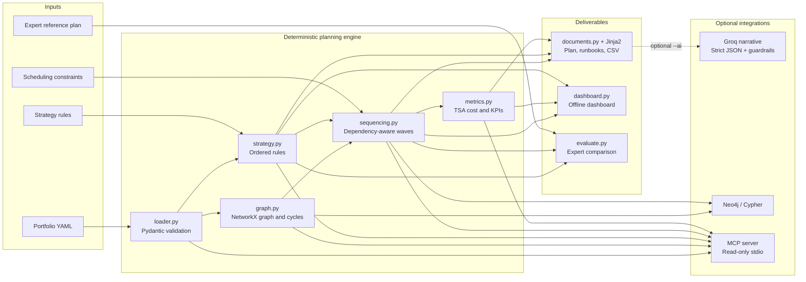
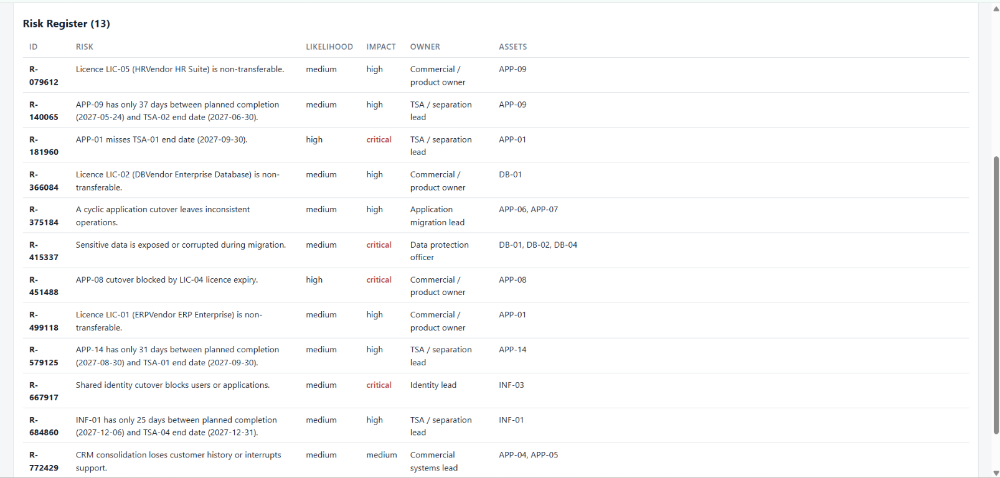

# Carve-out Copilot

> **Deterministic IT separation planner powered by dependency-graph analysis.**
> Built for the *Nordia Retail* carve-out from Atlas Group — 30 assets, a six-wave current plan, TSA cost visibility and conflict detection.

[](https://www.python.org/)
[](LICENSE)
[](#5--pipeline-commands)

---

## Table of Contents

1. [What is this project?](#1--what-is-this-project)
2. [How it works](#2--how-it-works)
3. [Project structure](#3--project-structure)
4. [Installation](#4--installation)
5. [Pipeline commands](#5--pipeline-commands)
6. [Interactive Dashboard](#6--interactive-dashboard)
7. [Screenshots](#7--screenshots)
8. [Data model](#8--data-model)
9. [Configuration](#9--configuration)
10. [AI narrative generation (optional)](#10--ai-narrative-generation-optional)
11. [MCP server (optional)](#11--mcp-server-optional)
12. [Neo4j & Cypher graph analytics](#12--neo4j--cypher-graph-analytics)
13. [Running tests](#13--running-tests)
14. [Contributing / pushing changes](#14--contributing--pushing-changes)

---

## 1 · What is this project?

**Carve-out Copilot** is a Python toolkit that automates the planning of an IT portfolio separation — the kind of work needed when a business unit is sold, spun off, or legally carved out of a parent company.

Given a YAML description of:
- **Assets** (apps, databases, infrastructure)
- **Dependencies** between them
- **TSA services** (Transitional Service Agreements — temporary services the parent keeps running for the buyer)
- **Licences** that may expire during the transition
- **Planning constraints** (wave size, stabilisation gaps, freeze periods)

…the tool deterministically computes:

| Output | Description |
|---|---|
| **Migration waves** | Topologically sorted asset groups that respect all dependencies |
| **Strategy per asset** | Clone / Migrate / Rebuild / Retire / Retain-under-TSA |
| **Conflicts** | TSA expirations, licence clashes, circular dependencies |
| **TSA cost estimate** | Months × monthly rate per TSA service |
| **Runbooks** | Markdown cutover guides per wave |
| **Interactive dashboard** | Self-contained HTML with graph, Gantt, risk register |

---

## 2 · How it works

```
portfolio_v1.yaml   ──►  loader.py  ──►  graph.py (NetworkX DiGraph)
                                               │
                              ┌────────────────┤
                              ▼                ▼
                       strategy.py      sequencing.py
                       (rules-based)    (topological sort
                       per-asset        + conflict detection)
                       strategy                │
                              └────────────────┤
                                               ▼
                                         metrics.py
                                         (TSA cost, KPIs)
                                               │
                              ┌────────────────┤
                              ▼                ▼
                       documents.py      export_html()
                       (Jinja2            dashboard.html
                       runbooks)          graph.html
```

### Project architecture

The planner separates deterministic decisions from optional integrations and
presentation. The core pipeline validates the portfolio, builds its dependency
graph, assigns strategies, schedules waves, and derives metrics. Documents,
the dashboard, evaluation, Neo4j, and the read-only MCP server consume those
computed results.



**Key design principle:** the algorithm is fully deterministic. No LLM is involved in planning — AI is an optional layer that wraps computed results with human-readable narrative. See [docs/architecture.md](docs/architecture.md) for the full system architecture and Mermaid diagrams.

---

## 3 · Project structure

```
d:\graph\
├── data/
│   ├── portfolio_v1.yaml        ← Main portfolio definition
│   ├── portfolio_v2.yaml        ← Robustness-test variant
│   ├── portfolio_v3.yaml        ← Independent Helios blind-test input; schema validation only
│   └── expert_plan_v1.yaml      ← Hand-authored reference plan (for evaluation)
├── config/
│   ├── strategy_rules.yaml      ← Rules for strategy assignment
│   └── constraints.yaml         ← Wave size, freeze periods, gap weeks
├── src/carveout/
│   ├── models.py                ← Pydantic data model (Asset, Relationship, TSA…)
│   ├── loader.py                ← YAML loader + portfolio validation
│   ├── graph.py                 ← NetworkX graph, dependency queries, HTML export
│   ├── strategy.py              ← Rules-based strategy assignment per asset
│   ├── sequencing.py            ← Wave computation + conflict detection
│   ├── metrics.py               ← TSA cost, KPI aggregation
│   ├── neo4j_store.py           ← Neo4j loader, query runner & Cypher exporter
│   ├── cypher_queries.py        ← 12 named Cypher analytics queries
│   ├── cli.py                   ← CLI entry point (carveout <command>)
│   ├── mcp_server.py            ← Read-only MCP tools over stdio
│   └── generation/
│       ├── client.py            ← Groq API client (AI mode)
│       ├── documents.py         ← Jinja2 runbook + plan generation
│       └── guardrails.py        ← Output validation
├── templates/
│   ├── cutover_runbook.md.j2    ← Per-wave runbook template
│   └── separation_plan.md.j2   ← Full plan narrative template
├── output/                      ← Generated files (git-tracked for demo)
│   ├── dashboard.html           ← ⭐ Interactive separation dashboard
│   ├── graph.html               ← vis-network force-directed graph
│   ├── waves.json               ← Computed wave sequencing
│   ├── metrics.json             ← KPIs and TSA cost breakdown
│   ├── strategy_assessment.json ← Per-asset strategy decisions
│   ├── dependency_graph.json    ← NetworkX node-link JSON
│   ├── graph.cypher             ← Standalone Neo4j / Cypher import script
│   └── runbooks/wave-0*.md      ← Cutover runbooks per wave
├── evaluation/                  ← Pipeline vs expert comparison
├── tests/                       ← pytest test suite
├── schema/portfolio.schema.json ← JSON Schema for portfolio validation
└── docs/screenshots/            ← Dashboard screenshots
```

---

## 4 · Installation

**Requirements:** Python 3.11 or newer, Git.

```powershell
# 1 — Clone the repository
git clone https://github.com/maryem37/splitwise-it.git
cd splitwise-it

# 2 — Create and activate a virtual environment
py -m venv .venv
.venv\Scripts\Activate.ps1

# 3 — Install the project (editable, with dev dependencies)
py -m pip install -e ".[dev]"
```

> **Windows execution policy:** if PowerShell blocks `.ps1` scripts, run once:
> ```powershell
> Set-ExecutionPolicy -Scope CurrentUser RemoteSigned
> ```

**Optional — AI narrative generation** (requires a free [Groq](https://console.groq.com) API key):
```powershell
py -m pip install -e ".[ai]"
copy .env.example .env        # then edit .env and set GROQ_API_KEY=...
```

**Optional — Neo4j graph database integration**:
```powershell
py -m pip install -e ".[neo4j]"
```

**Optional — local read-only MCP server**:
```powershell
py -m pip install -e ".[mcp]"
```

---

## 5 · Pipeline commands

All commands accept `--portfolio`, `--output`, `--rules`, `--constraints` overrides.

```powershell
# Activate venv first
.venv\Scripts\Activate.ps1

# ── Individual steps ─────────────────────────────────────────────
carveout validate     # Validate portfolio YAML; prints asset count
carveout schema       # Export JSON Schema for the portfolio model
carveout graph        # Build dependency graph → dependency_graph.json + graph.html
carveout strategy     # Assign exit strategy per asset → strategy_assessment.json
carveout waves        # Compute migration waves + conflicts → waves.json + metrics.json
carveout generate     # Generate runbooks and separation plan (Markdown)
carveout evaluate     # Compare pipeline output vs expert plan

# ── Run everything at once ───────────────────────────────────────
carveout run-all                # deterministic only
carveout run-all --ai           # + AI narrative (requires GROQ_API_KEY)

# ── Neo4j & Cypher ───────────────────────────────────────────────
carveout neo4j-export           # Export standalone output/graph.cypher (no DB needed)
carveout neo4j-load             # Load portfolio + waves into Neo4j
carveout neo4j-query --query transitive_impact --asset INF-01
carveout cypher-list            # Print all 12 named Cypher queries
```

**All outputs are written to `output/`** (overwritten on each run).

### Quick start — 3 commands to see the dashboard

```powershell
.venv\Scripts\Activate.ps1
carveout run-all
Start-Process "output\dashboard.html"
```

---

## 6 · Interactive Dashboard

`output/dashboard.html` is a **fully self-contained, offline-ready** single-page dashboard — no server, no CDN, no API calls needed.

### Open it

```powershell
# Option A — open directly in the browser
Start-Process "d:\graph\output\dashboard.html"

# Option B — serve locally (avoids browser CORS restrictions)
cd output
py -m http.server 8080
# then open http://localhost:8080/dashboard.html
```

### Dashboard tabs

| Tab | What you see |
|---|---|
| **📊 Dependency Graph** | All 30 assets arranged across the six waves in the current portfolio v1 run. Click any node to highlight its direct dependencies (blue arrows) and dependants (orange arrows). Assets with active conflicts have a **red outline**; cycle members have an **orange outline**. |
| **📅 Gantt Calendar** | Wave bars across the current 2027 plan, with TSA dates and the target exit date shown for schedule context. |
| **⚠️ Conflicts & Risks** | The current run shows two open conflicts and a 13-item risk register, including licence and TSA exposure, the dependency cycle, sensitive data, identity and duplicate-function risks. |
| **💲 TSA Cost Breakdown** | Per-TSA estimated cost with proportional bars, months of service needed, and extensibility flags. |

### KPI bar

| KPI | Value | Meaning |
|---|---|---|
| Waves | 6 | Migration waves computed by topological sort |
| Assets | 30 | Total assets in the portfolio |
| Cycle | 1 | APP-06 ↔ APP-07 mutual dependency (needs coordinated cutover) |
| Conflicts | 2 | APP-08 licence expiry and APP-01 TSA-01 end-date exposure |
| Latest completion | **6 Dec 2027** | 25 days before the 31 Dec 2027 target TSA exit |
| TSA cost | **$1.93 M** | Estimated across the four TSA services |

---

## 7 · Screenshots

The original screenshots 01–08 are retained. Screenshots 09–10 document the
latest six-wave dashboard and its current risk register.

### Dashboard — Dependency Graph (overview)


---

### Clicking an asset — dependency highlighting (APP-09 HR & Payroll)
> Blue arrows = what this asset depends on. Orange arrows = what depends on it. Red text = active TSA conflict.


---

### Clicking an asset with a TSA conflict (DB-05 Data Warehouse)
> DB-05 (Wave 7, Jan 2029) is in conflict: TSA-04 ends Dec 2027 — a gap of 12 months.


---

### Gantt Calendar tab
> Waves 1–4 complete before the Dec 2027 target; Waves 5–8 extend well beyond it.
> The red dashed line = TSA-01 hard stop (30 Sep 2027). The orange dashed line = target exit.


---

### Conflicts & Risks tab
> 7 detected conflicts (licence expiry + TSA deadline overruns) and an 8-row risk register.


---

### TSA conflict — INF-01 Atlas Paris Data Centre (last wave)
> INF-01 (Wave 8, Mar 2029) is the final asset — it anchors TSA-04 cost for 27 months.


---

### Project in VS Code — running the pipeline
> Terminal shows `.venv\Scripts\Activate.ps1` → `carveout run-all` → `Start-Process dashboard.html`.


---

### vis-network force-directed graph (`output/graph.html`)
> Alternative visualisation generated by `carveout graph`. Blue = shared assets, yellow = carved-out, red arrow = dependency cycle.


### Latest dashboard — six-wave plan
> Current portfolio v1 snapshot: 30 assets, one dependency cycle, two open conflicts, completion on 6 Dec 2027, and estimated TSA cost of $1.93M.


### Latest dashboard — risk register
> The current register contains 13 identified risks, with likelihood, impact, owner and affected assets shown for review.



---

## 8 · Data model

Defined in `src/carveout/models.py` using **Pydantic v2**.

```
Portfolio
├── Planning          company, day1, cutover_start, target_tsa_exit, max_assets_per_wave
├── Asset[]           id, name, type, owner, criticality, users, exit_strategy,
│                     effort_weeks, build_effort_weeks, licence_id, tsa_id, sensitive
├── Relationship[]    source, target, type (CALLS / READS_FROM / WRITES_TO /
│                                           HOSTED_ON / AUTHENTICATES_VIA / CONNECTS_VIA)
├── Licence[]         id, vendor, product, end_date, transferable, annual_cost
└── TSAService[]      id, service, start_date, end_date, monthly_cost,
                      extendable, extension_months
```

**Owners:** `carved_out` | `shared` | `parent`  
**Asset types:** `application` | `datastore` | `infrastructure`  
**Strategies:** `clone` | `migrate` | `rebuild` | `retire` | `retain_under_tsa`

---

## 9 · Configuration

### `config/strategy_rules.yaml`
Ordered list of rules; first match wins. Each rule specifies conditions (owner, type, function, criticality) and the resulting strategy.

### `config/constraints.yaml`
```yaml
max_assets_per_wave: 8     # hard cap per wave
weeks_per_wave_gap: 2      # stabilisation gap between waves
freeze_periods: []         # date ranges when no wave may start
```

### `data/portfolio_v1.yaml`
The main portfolio input. Edit assets, relationships, licences, or TSA services here, then re-run `carveout run-all` to regenerate all outputs.

### `data/portfolio_v3.yaml`
An independent fictional Helios Utilities portfolio supplied for a blind test.
It contains 30 assets, four TSA services and eight licences. It has been
schema-validated only: no expert answer file or planning, sensitivity or
evaluation output has been generated for this portfolio.

---

## 10 · AI narrative generation (optional)

With `--ai`, the `generate` and `run-all` commands call the **Groq API** (free tier available) to wrap computed results with human-readable narrative in runbooks and the separation plan.

```powershell
# 1 — Install AI extras
py -m pip install -e ".[ai]"

# 2 — Set your API key in .env
# GROQ_API_KEY=gsk_...

# 3 — Run with AI
carveout run-all --ai
```

The AI **never changes the data** — it only narrates what the algorithm already computed. All strategic decisions (wave order, conflict flags, TSA cost) are deterministic.

---

## 11 · MCP server (optional)

The optional `carveout-mcp` server exposes the deterministic planner over the
Model Context Protocol's local `stdio` transport. It is read-only: tools
inspect YAML inputs and compute results in memory without writing generated
files or calling an LLM.

Available tools:

| Tool | Purpose |
|---|---|
| `portfolio_summary` | Company, planning dates, and counts of assets, relationships, licences, TSA services and sensitive assets |
| `list_assets` | Asset IDs, type, owner, criticality, users, function, sensitivity flag, effort, licence and TSA IDs; optional type, owner and sensitivity filters |
| `asset_dependencies` | Transitive prerequisites and dependants for one asset. Edges follow `source depends on target`. |
| `compute_plan` | Deterministic strategies, waves, cycles, metrics and conflicts, computed in memory |

The server reads the portfolio and configuration locally. It exposes no
write tools, does not create files, and does not send portfolio data to an
LLM or remote MCP service. `CARVEOUT_PORTFOLIO`, `CARVEOUT_RULES`, and
`CARVEOUT_CONSTRAINTS` select local input files; relative paths resolve from
the repository root. Paths are not accepted as tool-call arguments.

After installing the `mcp` extra, configure the local server in VS Code:

```json
{
  "servers": {
    "carveout": {
      "type": "stdio",
      "command": "${workspaceFolder}\\.venv\\Scripts\\python.exe",
      "args": ["-m", "carveout.mcp_server"],
      "env": {
        "CARVEOUT_PORTFOLIO": "${workspaceFolder}\\data\\portfolio_v1.yaml"
      }
    }
  }
}
```

## 12 · Neo4j & Cypher graph analytics

The project includes a full **Neo4j** integration (`src/carveout/neo4j_store.py`) and a catalogue of **12 named Cypher queries** (`src/carveout/cypher_queries.py`).

### Graph schema in Neo4j

- **Nodes:** `:Asset` (enriched with `wave`, `strategy`, `planned_completion`), `:TSAService`, `:Licence`
- **Relationships:** `:CALLS`, `:READS_FROM`, `:WRITES_TO`, `:HOSTED_ON`, `:AUTHENTICATES_VIA`, `:CONNECTS_VIA`, `:COVERED_BY_TSA`, `:LICENSED_UNDER`

### Export & run

```powershell
# 1 — Export standalone Cypher script (no running Neo4j required)
carveout neo4j-export           # writes output/graph.cypher

# 2 — Load directly into a running Neo4j instance
carveout neo4j-load --neo4j-uri bolt://localhost:7687 --neo4j-user neo4j --neo4j-password secret

# 3 — Run any of the 12 named analytics queries
carveout neo4j-query --query transitive_impact --asset INF-01
carveout neo4j-query --query tsa_conflicts
carveout neo4j-query --query critical_path
carveout neo4j-query --query cycles
```

### Included Cypher queries

| Query name | Purpose |
|---|---|
| `transitive_deps` | All assets that a given asset depends on (directly or transitively) |
| `transitive_impact` | All assets impacted if a given asset slips |
| `tsa_conflicts` | Assets completing after their TSA end date |
| `licence_conflicts` | Assets whose licence expires before cutover |
| `critical_path` | Longest dependency chain determining the end date |
| `cycles` | Circular dependency pairs (`APP-06` ↔ `APP-07`) |
| `shared_blockers` | Shared parent assets blocking the most downstream systems |
| `assets_by_wave` | Assets in a specific wave with strategy and completion date |
| `tsa_cost_summary` | Per-TSA latest cutover and asset count |
| `sensitive_assets` | Assets holding personal/financial data (GDPR) |
| `wave_predecessors` | Waves that must complete before a given wave |
| `full_graph` | Full node-and-edge export |

---

## 13 · Running tests

```powershell
.venv\Scripts\Activate.ps1
pytest -v
```

Test modules:

| File | What it tests |
|---|---|
| `tests/test_loader.py` | YAML loading, schema validation, error cases |
| `tests/test_planning.py` | Wave computation, strategy assignment, conflict detection |
| `tests/test_sensitivity.py` | Scenario, Monte Carlo, mitigation and critical-path results |
| `tests/test_generation.py` | Document rendering, risk register, guardrails |
| `tests/test_mcp_server.py` | MCP tool behavior and local stdio protocol |

---

## 14 · Contributing / pushing changes

```powershell
# Stage everything (new files + modifications)
git add -A

# Commit with a meaningful message
git commit -m "feat: describe what you changed"

# Push to GitHub
git push origin main
```

Repository: **https://github.com/maryem37/splitwise-it**

---

## Licence

[MIT](LICENSE) — Maryem, 2026.
