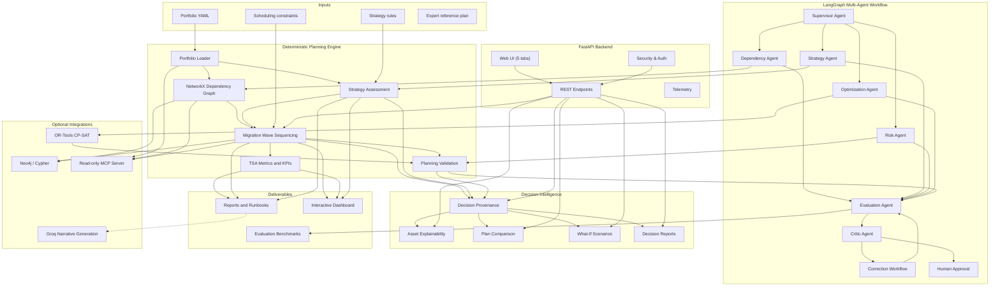
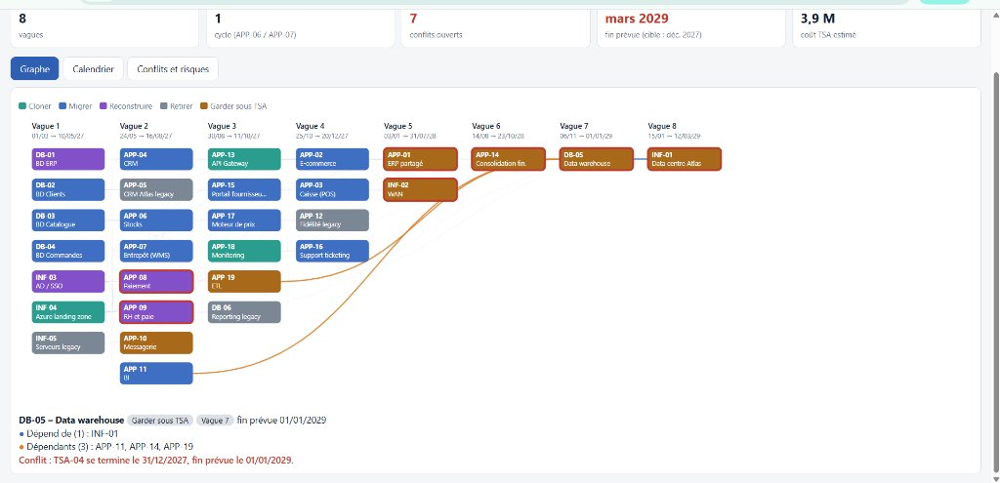
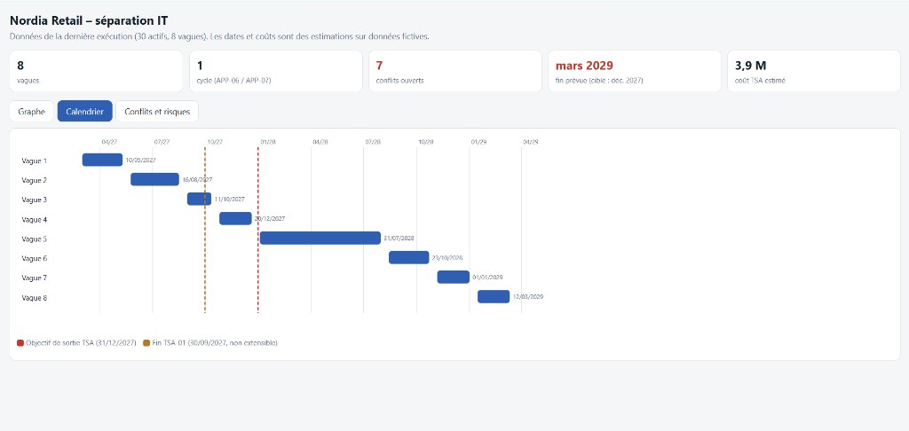
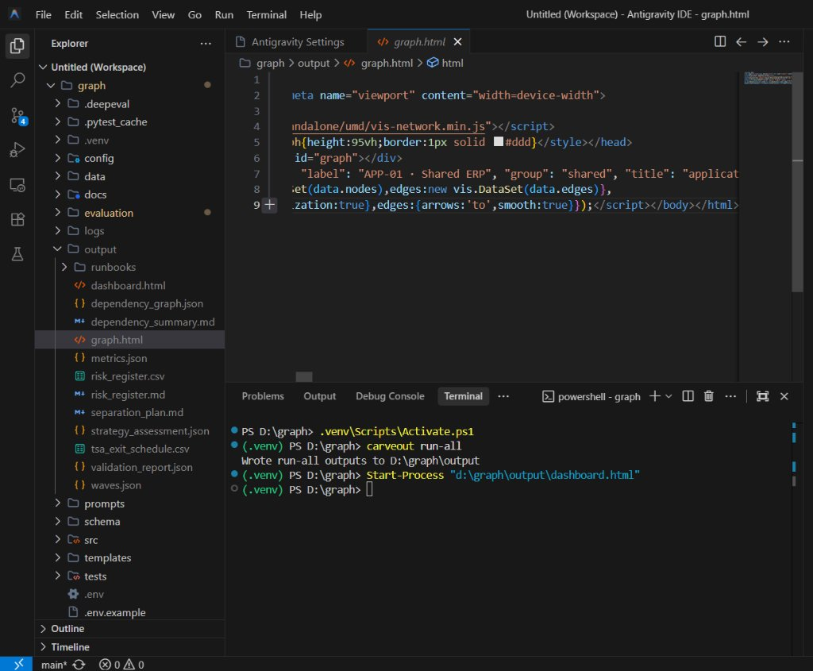

# Carve-out Copilot

> **Deterministic IT separation planner powered by dependency-graph analysis, multi-agent orchestration and constraint-based optimization.**
>
> Built for the *Nordia Retail* carve-out from Atlas Group — 30 assets, dependency-aware migration planning, TSA cost visibility, conflict detection and AI-assisted decision support.

[](https://www.python.org/)
[](LICENSE)
[](#15--running-tests)
[](#5--pipeline-commands)
[](https://www.langchain.com/langgraph)
[](https://developers.google.com/optimization)
[](https://fastapi.tiangolo.com/)
[](#18--docker-deployment)

---

## Table of Contents

1. [What is this project?](#1--what-is-this-project)
2. [How it works](#2--how-it-works)
3. [Project structure](#3--project-structure)
4. [Installation](#4--installation)
5. [How to run](#5--how-to-run)
6. [Pipeline commands](#6--pipeline-commands)
7. [Interactive Dashboard](#7--interactive-dashboard)
8. [Screenshots](#8--screenshots)
9. [Data model](#9--data-model)
10. [Configuration](#10--configuration)
11. [AI narrative generation](#11--ai-narrative-generation-optional)
12. [MCP server](#12--mcp-server-optional)
13. [Neo4j & Cypher graph analytics](#13--neo4j--cypher-graph-analytics)
14. [Agentic architecture and optimization](#14--agentic-architecture-and-optimization)
15. [Evaluation and human-in-the-loop](#15--evaluation-and-human-in-the-loop)
16. [Decision Intelligence (Phase 4)](#16--decision-intelligence-phase-4)
17. [FastAPI Backend & Web UI (Phase 5)](#17--fastapi-backend--web-ui-phase-5)
18. [Docker Deployment](#18--docker-deployment)
19. [API Reference](#19--api-reference)
20. [Environment Variables](#20--environment-variables)
21. [Security Scope](#21--security-scope)
22. [Running tests](#22--running-tests)
23. [Known Limitations](#23--known-limitations)
24. [Contributing / pushing changes](#24--contributing--pushing-changes)
25. [License](#license)

---

## 1 · What is this project?

**Carve-out Copilot** is a Python toolkit designed to automate and support IT portfolio separation planning — the process required when a business unit is sold, spun off, or legally separated from its parent company.

The project uses a fictional enterprise scenario: **Nordia Retail**, a business being separated from **Atlas Group**.

An IT carve-out involves identifying which applications, databases and infrastructure components must be migrated, rebuilt, cloned, retired or temporarily retained through Transitional Service Agreements (TSAs).

Given a YAML description of:

- **Assets:** applications, databases and infrastructure.
- **Dependencies:** technical relationships between assets.
- **TSA services:** temporary services maintained by the parent company.
- **Licences:** software licences that may expire during the transition.
- **Planning constraints:** wave capacity, stabilisation gaps and freeze periods.
- **Strategy rules:** conditions used to determine the appropriate exit strategy.

The system computes a dependency-aware separation plan and provides reports, runbooks, an interactive dashboard and optional analytical integrations.

### Main capabilities

| Capability | Description |
|---|---|
| Dependency analysis | Direct and transitive dependencies, impact analysis and cycle detection |
| Migration planning | Deterministic, dependency-aware migration waves |
| Strategy assessment | Clone, Migrate, Rebuild, Retire and Retain-under-TSA |
| Conflict detection | TSA deadlines, licence expirations and circular dependencies |
| TSA cost estimation | Estimated service cost based on duration and monthly rates |
| Runbook generation | Markdown cutover guides for each migration wave |
| Interactive dashboard | Offline HTML dashboard with graph, Gantt and risk register |
| Multi-agent investigation | Specialized LangGraph agents using deterministic Python tools |
| Schedule optimization | OR-Tools CP-SAT scenario optimization |
| Workflow evaluation | Evidence checks, planning validation and critic decisions |
| Human approval | Interrupt-based human-in-the-loop workflow |
| SQLite persistence | Cross-process checkpoint storage with WAL mode |
| Decision provenance | Structured record of every planning decision with rationale |
| Explainability | Per-asset wave assignment explanation with dependency context |
| Plan comparison | Baseline vs optimized side-by-side reconciliation |
| What-if scenarios | Isolated parameter simulations without mutating source YAML |
| Decision reports | Markdown and JSON audit-ready planning packages |
| REST API | FastAPI backend exposing all planning capabilities |
| Web UI | Five-tab interactive interface served by the API |
| Graph analytics | Optional Neo4j integration and named Cypher queries |
| MCP integration | Optional read-only Model Context Protocol server |

**Key design principle:** deterministic algorithms remain the source of truth for planning, scheduling, validation and financial calculations. LLMs help interpret requests and explain results, but do not override deterministic planning constraints.

---

## 2 · How it works

### 2.1 Deterministic planning pipeline

The original planning pipeline validates the portfolio, constructs the dependency graph, assigns strategies, schedules migration waves and calculates the resulting metrics.

```text
portfolio_v1.yaml
        |
        v
    loader.py
        |
        v
    graph.py
    NetworkX DiGraph
        |
        +----------------------+
        |                      |
        v                      v
  strategy.py            sequencing.py
  Rules-based             Dependency-aware
  assessment              wave computation
        |                      |
        +----------+-----------+
                   |
                   v
               metrics.py
             TSA costs / KPIs
                   |
          +--------+--------+
          |                 |
          v                 v
     documents.py       dashboard.py
     Jinja2 reports     Offline HTML
     and runbooks       visualizations
```

### 2.2 Overall system architecture

The planner separates deterministic computation, agent orchestration, evaluation and optional integrations.



### 2.3 Two complementary planning approaches

The project provides two distinct planning approaches.

| Approach | Purpose | Main technology |
|---|---|---|
| Deterministic planner | Establish a reproducible dependency-aware baseline | NetworkX and Python |
| Constraint optimizer | Explore alternative feasible migration schedules | OR-Tools CP-SAT |

The deterministic planner groups assets according to dependency ordering and planning rules.

The CP-SAT optimizer explores alternative assignments while enforcing modeled constraints, including dependency ordering, strongly connected component coupling, wave capacity and scenario delay requirements. The solver uses `num_search_workers=1` and `random_seed=42` for fully reproducible results across runs.

The two approaches are complementary. Their scheduling strategies differ, so their wave counts and estimated TSA costs can differ.

### 2.4 Why combine deterministic planning and agents?

A conventional planner computes a schedule but does not necessarily explain the consequences of a business question such as:

> What happens if we delay APP-06 by three months?

The agentic layer coordinates specialized investigations:

1. The Supervisor interprets the request.
2. The Dependency Agent investigates affected assets and dependencies.
3. The Strategy Agent retrieves deterministic strategy assessments.
4. The Risk Agent identifies relevant risks and conflicts.
5. The Optimization Agent evaluates alternative schedules when required.
6. The Evaluation Agent checks evidence and planning validity.
7. The Critic Agent determines whether the result is acceptable, needs correction or requires human review.
8. The approval workflow can pause for a human decision.

Agents call Python tools that use the existing planning engine. They do not replace the underlying algorithms.

---

## 3 · Project structure

```text
splitwise-it/
│
├── data/
│   ├── portfolio_v1.yaml          # Main Nordia Retail portfolio (30 assets)
│   ├── portfolio_v2.yaml          # Alternative portfolio variant
│   ├── portfolio_v3.yaml          # Helios Utilities blind-test portfolio
│   └── expert_plan_v1.yaml        # Reference plan for evaluation benchmarks
│
├── config/
│   ├── strategy_rules.yaml        # Ordered exit-strategy decision rules
│   └── constraints.yaml           # Wave capacity, gaps, freeze periods
│
├── src/carveout/
│   ├── models.py                  # Pydantic v2 data model (Portfolio, Asset, …)
│   ├── loader.py                  # YAML loading and schema validation
│   ├── graph.py                   # NetworkX dependency graph construction
│   ├── strategy.py                # Rules-based exit-strategy assessment
│   ├── sequencing.py              # Dependency-aware wave computation
│   ├── metrics.py                 # TSA costs and KPI calculation
│   ├── sensitivity.py             # Scenario and Monte Carlo analysis
│   ├── neo4j_store.py             # Neo4j integration
│   ├── cypher_queries.py          # 12 named Cypher analytics queries
│   ├── cli.py                     # CLI entry point (all subcommands)
│   ├── mcp_server.py              # Read-only MCP server (stdio)
│   ├── config.py                  # Environment variable configuration
│   ├── decision_provenance.py     # Structured decision provenance model
│   ├── explain.py                 # Per-asset wave assignment explainability
│   ├── comparison.py              # Baseline vs optimized plan comparison
│   ├── scenarios_manager.py       # Isolated what-if scenario execution
│   ├── decision_report.py         # Markdown and JSON decision reports
│   ├── logging_config.py          # Structured logging (JSON/plain)
│   │
│   ├── agents/
│   │   ├── supervisor.py          # Supervisor: intent classification and routing
│   │   ├── dependency_agent.py    # Dependency graph investigation
│   │   ├── strategy_agent.py      # Exit-strategy retrieval and comparison
│   │   ├── risk_agent.py          # Risk and conflict aggregation
│   │   ├── optimization_agent.py  # CP-SAT schedule optimization
│   │   ├── evaluation_agent.py    # Evidence and constraint verification
│   │   └── critic_agent.py        # Deterministic critic decision policy
│   │
│   ├── tools/
│   │   ├── graph_tools.py         # Graph tool wrappers for agents
│   │   ├── planning_tools.py      # Planning tool wrappers
│   │   ├── risk_tools.py          # Risk tool wrappers
│   │   ├── strategy_tools.py      # Strategy tool wrappers
│   │   ├── optimization_tools.py  # Optimization tool wrappers
│   │   ├── neo4j_tools.py         # Neo4j tool wrappers
│   │   └── correction_tools.py    # Bounded correction-loop tools
│   │
│   ├── workflows/
│   │   ├── state.py               # LangGraph CarveoutState definition
│   │   ├── routing.py             # Conditional edge routing
│   │   ├── approval.py            # Human-in-the-loop interrupt
│   │   ├── graph.py               # LangGraph workflow compilation
│   │   ├── checkpointer.py        # SQLite checkpoint persistence (WAL)
│   │   └── metrics.py             # Workflow execution telemetry
│   │
│   ├── optimization/
│   │   ├── models.py              # OptimizationConfig, SolverResult
│   │   ├── solver.py              # CP-SAT solver (num_search_workers=1)
│   │   ├── validation.py          # Constraint validation
│   │   └── scenarios.py           # Delay-scenario helpers
│   │
│   ├── evaluation/
│   │   ├── metrics.py             # Evaluation metrics
│   │   └── benchmarks.py          # 10 evaluation benchmarks vs expert plan
│   │
│   ├── generation/
│   │   ├── client.py              # Groq LLM client
│   │   ├── documents.py           # Jinja2 report and runbook generation
│   │   └── guardrails.py          # LLM output guardrails
│   │
│   └── api/
│       ├── app.py                 # FastAPI application (lifespan, routes)
│       ├── schemas.py             # Pydantic request/response schemas
│       ├── security.py            # Approval token and CORS security
│       ├── telemetry.py           # TelemetryTracker (HTTP + workflow metrics)
│       └── ui.py                  # Web UI HTML (5 tabs)
│
├── templates/
│   ├── cutover_runbook.md.j2      # Wave cutover runbook template
│   └── separation_plan.md.j2      # Separation plan summary template
│
├── output/                        # Generated outputs (gitignored)
│   ├── dashboard.html
│   ├── graph.html
│   ├── waves.json
│   ├── metrics.json
│   ├── strategy_assessment.json
│   ├── dependency_graph.json
│   ├── graph.cypher
│   └── runbooks/
│
├── tests/                         # 102 tests, 0 failures
│   ├── test_loader.py
│   ├── test_planning.py
│   ├── test_sensitivity.py
│   ├── test_generation.py
│   ├── test_mcp_server.py
│   ├── test_tools.py
│   ├── test_agents.py
│   ├── test_optimization.py
│   ├── test_evaluation.py
│   ├── test_critic.py
│   ├── test_correction_loop.py
│   ├── test_human_approval.py
│   ├── test_checkpoint_persistence.py
│   ├── test_cross_process_resume.py
│   ├── test_workflow_reliability.py
│   ├── test_observability.py
│   ├── test_operational_reliability.py
│   ├── test_decision_intelligence.py
│   ├── test_scenarios_and_reporting.py
│   ├── test_api_and_e2e.py
│   └── test_phase6_operational.py
│
├── schema/
│   └── portfolio.schema.json      # JSON Schema for portfolio YAML
│
├── docs/
│   ├── architecture.md
│   └── screenshots/               # 10 dashboard screenshots
│
├── Dockerfile                     # Multi-stage production image
├── docker-compose.yml             # Service + persistent volume
├── .dockerignore
├── .env.example                   # Environment variable template
├── pyproject.toml                 # Package metadata and extras
├── README.md
└── LICENSE
```

*The structure describes the principal project modules. Optional integrations and generated files depend on installed extras and executed commands.*

---

## 4 · Installation

### Requirements

- Python 3.11 or newer
- Git
- Windows, Linux or macOS

### Clone the repository

```powershell
git clone https://github.com/maryem37/splitwise-it.git
cd splitwise-it
```

### Create a virtual environment

```powershell
py -m venv .venv
.venv\Scripts\Activate.ps1
```

If PowerShell blocks activation scripts:

```powershell
Set-ExecutionPolicy -Scope CurrentUser -ExecutionPolicy RemoteSigned
```

### Install the package

```powershell
# Core deterministic planner only
pip install -e .

# All capabilities including agents, optimization and API
pip install -e ".[agents,optimization,api]"
```

### Configure environment variables (optional)

```powershell
copy .env.example .env
# Edit .env to set GROQ_API_KEY, CARVEOUT_APPROVAL_TOKEN, etc.
```

---

## 5 · How to run

### Method 1 — Deterministic planning only (no extras needed)

```powershell
.venv\Scripts\Activate.ps1
carveout run-all
Start-Process "output\dashboard.html"
```

### Method 2 — Agentic investigation

```powershell
.venv\Scripts\Activate.ps1
pip install -e ".[agents,optimization]"
carveout agent "What happens if we delay APP-06 by three months?"
```

### Method 3 — CP-SAT optimization scenarios

```powershell
.venv\Scripts\Activate.ps1
pip install -e ".[optimization]"
carveout optimize --scenario minimize_cost --objective minimize_cost
carveout compare
```

### Method 4 — Decision Intelligence (Phase 4)

```powershell
.venv\Scripts\Activate.ps1
# Explain why an asset is in its assigned wave
carveout explain APP-06

# Compare baseline vs optimized plan
carveout compare --scenario minimize_cost

# Run an isolated what-if scenario
carveout scenario --delay-asset APP-06 --delay-weeks 8

# Generate a Markdown decision report
carveout report --format markdown --report-output output/decision_report.md
```

### Method 5 — FastAPI REST API and Web UI

```powershell
.venv\Scripts\Activate.ps1
pip install -e ".[agents,optimization,api]"
carveout-api
# Web UI:    http://127.0.0.1:8000
# OpenAPI:   http://127.0.0.1:8000/docs
# Health:    http://127.0.0.1:8000/api/health
# Readiness: http://127.0.0.1:8000/api/ready
```

### Method 6 — Docker

```powershell
# Build and start in detached mode
docker compose up --build -d

# View logs
docker compose logs -f carveout

# Health check
Invoke-RestMethod http://localhost:8000/api/health

# Readiness check
Invoke-RestMethod http://localhost:8000/api/ready

# Stop
docker compose down
```

---

## 6 · Pipeline commands

```powershell
# Activate venv first
.venv\Scripts\Activate.ps1

# ── Individual planning steps ─────────────────────────────────────────────
carveout validate     # Validate portfolio YAML; prints asset count
carveout schema       # Export JSON Schema for the portfolio model
carveout graph        # Build dependency graph → dependency_graph.json + graph.html
carveout strategy     # Assign exit strategy per asset → strategy_assessment.json
carveout waves        # Compute migration waves + conflicts → waves.json + metrics.json
carveout generate     # Generate runbooks and separation plan (Markdown)
carveout evaluate     # Compare pipeline output vs expert plan

# ── Run everything at once ───────────────────────────────────────────────
carveout run-all                # deterministic only
carveout run-all --ai           # + AI narrative (requires GROQ_API_KEY)

# ── Neo4j & Cypher ───────────────────────────────────────────────────────
carveout neo4j-export           # Export standalone output/graph.cypher (no DB needed)
carveout neo4j-load             # Load portfolio + waves into Neo4j
carveout neo4j-query --query transitive_impact --asset INF-01
carveout cypher-list            # Print all 12 named Cypher queries

# ── Agentic Investigation & CP-SAT Optimization ──────────────────────────
carveout agent "What happens if we delay APP-06 by three months?"
carveout agent --human-review --thread-id review-01 "Optimize schedule to minimize cost"
carveout optimize --scenario baseline
carveout optimize --scenario app_06_delay --delay-weeks 12
carveout optimize --scenario minimize_cost --objective minimize_cost
carveout optimize --scenario minimize_duration --objective minimize_duration
carveout optimize --scenario balanced --objective balanced

# ── Cross-process workflow inspection & resumption ───────────────────────
carveout agent-status --thread-id review-01
carveout agent-resume --thread-id review-01 --action APPROVE --comment "Approved by PMO"
carveout agent-resume --thread-id review-01 --action REJECT
carveout agent-resume --thread-id review-01 --action REQUEST_REVISION --comment "Needs cost review"

# ── Decision Intelligence (Phase 4) ──────────────────────────────────────
carveout explain APP-06                        # Explain wave assignment for one asset
carveout explain DB-05                         # Another asset explanation
carveout compare                               # Baseline vs default optimized plan
carveout compare --scenario minimize_cost      # Baseline vs named scenario
carveout scenario --delay-asset APP-06 --delay-weeks 8          # What-if: delay one asset
carveout scenario --rate-multiplier 1.5        # What-if: TSA cost increase
carveout scenario --delay-asset APP-01 --delay-weeks 4 --rate-multiplier 1.2
carveout report --format markdown              # Generate Markdown decision report
carveout report --format json                  # Generate JSON decision report
carveout report --format markdown --report-output output/my_report.md
```

**All outputs are written to `output/`** (overwritten on each run).

---

## 7 · Interactive Dashboard

`output/dashboard.html` is a **fully self-contained, offline-ready** single-page dashboard — no server, no CDN, no API calls needed.

### Open it

```powershell
# Option A — open directly in the browser
Start-Process "d:\graph\output\dashboard.html"

# Option B — serve locally (avoids browser CORS restrictions)
cd output
py -m http.server 8080
# then open http://localhost:8080/dashboard.html
```

### Dashboard tabs

| Tab | What you see |
|---|---|
| **📊 Dependency Graph** | All 30 assets arranged across the six waves in the current portfolio v1 run. Click any node to highlight its direct dependencies (blue arrows) and dependants (orange arrows). Assets with active conflicts have a **red outline**; cycle members have an **orange outline**. |
| **📅 Gantt Calendar** | Wave bars across the current 2027 plan, with TSA dates and the target exit date shown for schedule context. |
| **⚠️ Conflicts & Risks** | The current run shows two open conflicts and a 13-item risk register, including licence and TSA exposure, the dependency cycle, sensitive data, identity and duplicate-function risks. |
| **💲 TSA Cost Breakdown** | Per-TSA estimated cost with proportional bars, months of service needed, and extensibility flags. |
| **🧠 Decision Intelligence** | Plan comparison table (baseline vs CP-SAT) and decision provenance entries for each strategic choice. |

### KPI bar

| KPI | Value | Meaning |
|---|---|---|
| Waves | 6 | Migration waves computed by topological sort |
| Assets | 30 | Total assets in the portfolio |
| Cycle | 1 | APP-06 ↔ APP-07 mutual dependency (needs coordinated cutover) |
| Conflicts | 2 | APP-08 licence expiry and APP-01 TSA-01 end-date exposure |
| Latest completion | **6 Dec 2027** | 25 days before the 31 Dec 2027 target TSA exit |
| TSA cost | **$1.93 M** | Estimated across the four TSA services |

---

## 8 · Screenshots

The original screenshots 01–08 are retained. Screenshots 09–10 document the
latest six-wave dashboard and its current risk register.

### Dashboard — Dependency Graph (overview)


---

### Clicking an asset — dependency highlighting (APP-09 HR & Payroll)
> Blue arrows = what this asset depends on. Orange arrows = what depends on it. Red text = active TSA conflict.


---

### Clicking an asset with a TSA conflict (DB-05 Data Warehouse)
> DB-05 (Wave 7, Jan 2029) is in conflict: TSA-04 ends Dec 2027 — a gap of 12 months.



---

### Gantt Calendar tab
> Waves 1–4 complete before the Dec 2027 target; Waves 5–8 extend well beyond it.
> The red dashed line = TSA-01 hard stop (30 Sep 2027). The orange dashed line = target exit.



---

### Conflicts & Risks tab
> 7 detected conflicts (licence expiry + TSA deadline overruns) and an 8-row risk register.


---

### TSA conflict — INF-01 Atlas Paris Data Centre (last wave)
> INF-01 (Wave 8, Mar 2029) is the final asset — it anchors TSA-04 cost for 27 months.


---

### Project in VS Code — running the pipeline
> Terminal shows `.venv\Scripts\Activate.ps1` → `carveout run-all` → `Start-Process dashboard.html`.



---

### vis-network force-directed graph (`output/graph.html`)
> Alternative visualisation generated by `carveout graph`. Blue = shared assets, yellow = carved-out, red arrow = dependency cycle.


### Latest dashboard — six-wave plan
> Current portfolio v1 snapshot: 30 assets, one dependency cycle, two open conflicts, completion on 6 Dec 2027, and estimated TSA cost of $1.93M.


### Latest dashboard — risk register
> The current register contains 13 identified risks, with likelihood, impact, owner and affected assets shown for review.


---

## 9 · Data model

Defined in `src/carveout/models.py` using **Pydantic v2**.

```text
Portfolio
├── Planning          company, day1, cutover_start, target_tsa_exit, max_assets_per_wave
├── Asset[]           id, name, type, owner, criticality, users, exit_strategy,
│                     effort_weeks, build_effort_weeks, licence_id, tsa_id, sensitive
├── Relationship[]    source, target, type (CALLS / READS_FROM / WRITES_TO /
│                                           HOSTED_ON / AUTHENTICATES_VIA / CONNECTS_VIA)
├── Licence[]         id, vendor, product, end_date, transferable, annual_cost
└── TSAService[]      id, service, start_date, end_date, monthly_cost,
                      extendable, extension_months
```

**Owners:** `carved_out` | `shared` | `parent`
**Asset types:** `application` | `datastore` | `infrastructure`
**Strategies:** `clone` | `migrate` | `rebuild` | `retire` | `retain_under_tsa`

---

## 10 · Configuration

### `config/strategy_rules.yaml`

Ordered list of rules; first match wins. Each rule specifies conditions (owner, type, function, criticality) and the resulting strategy.

### `config/constraints.yaml`

```yaml
max_assets_per_wave: 8     # hard cap per wave
weeks_per_wave_gap: 2      # stabilisation gap between waves
freeze_periods: []         # date ranges when no wave may start
```

### `data/portfolio_v1.yaml`

The main portfolio input. Edit assets, relationships, licences, or TSA services here, then re-run `carveout run-all` to regenerate all outputs.

### `data/portfolio_v3.yaml`

An independent fictional Helios Utilities portfolio supplied for a blind test.
It contains 30 assets, four TSA services and eight licences. It has been
schema-validated only: no expert answer file or planning, sensitivity or
evaluation output has been generated for this portfolio.

---

## 11 · AI narrative generation (optional)

With `--ai`, the `generate` and `run-all` commands call the **Groq API** (free tier available) to wrap computed results with human-readable narrative in runbooks and the separation plan.

```powershell
# 1 — Install AI extras
py -m pip install -e ".[ai]"

# 2 — Set your API key in .env
# GROQ_API_KEY=gsk_...

# 3 — Run with AI
carveout run-all --ai
```

The AI **never changes the data** — it only narrates what the algorithm already computed. All strategic decisions (wave order, conflict flags, TSA cost) are deterministic.

---

## 12 · MCP server (optional)

The optional `carveout-mcp` server exposes the deterministic planner over the
Model Context Protocol's local `stdio` transport. It is read-only: tools
inspect YAML inputs and compute results in memory without writing generated
files or calling an LLM.

Available tools:

| Tool | Purpose |
|---|---|
| `portfolio_summary` | Company, planning dates, and counts of assets, relationships, licences, TSA services and sensitive assets |
| `list_assets` | Asset IDs, type, owner, criticality, users, function, sensitivity flag, effort, licence and TSA IDs; optional type, owner and sensitivity filters |
| `asset_dependencies` | Transitive prerequisites and dependants for one asset. Edges follow `source depends on target`. |
| `compute_plan` | Deterministic strategies, waves, cycles, metrics and conflicts, computed in memory |

The server reads the portfolio and configuration locally. It exposes no
write tools, does not create files, and does not send portfolio data to an
LLM or remote MCP service. `CARVEOUT_PORTFOLIO`, `CARVEOUT_RULES`, and
`CARVEOUT_CONSTRAINTS` select local input files; relative paths resolve from
the repository root. Paths are not accepted as tool-call arguments.

After installing the `mcp` extra, configure the local server in VS Code:

```json
{
  "servers": {
    "carveout": {
      "type": "stdio",
      "command": "${workspaceFolder}\\.venv\\Scripts\\python.exe",
      "args": ["-m", "carveout.mcp_server"],
      "env": {
        "CARVEOUT_PORTFOLIO": "${workspaceFolder}\\data\\portfolio_v1.yaml"
      }
    }
  }
}
```

---

## 13 · Neo4j & Cypher graph analytics

The project includes a full **Neo4j** integration (`src/carveout/neo4j_store.py`) and a catalogue of **12 named Cypher queries** (`src/carveout/cypher_queries.py`).

### Graph schema in Neo4j

- **Nodes:** `:Asset` (enriched with `wave`, `strategy`, `planned_completion`), `:TSAService`, `:Licence`
- **Relationships:** `:CALLS`, `:READS_FROM`, `:WRITES_TO`, `:HOSTED_ON`, `:AUTHENTICATES_VIA`, `:CONNECTS_VIA`, `:COVERED_BY_TSA`, `:LICENSED_UNDER`

### Export & run

```powershell
# 1 — Export standalone Cypher script (no running Neo4j required)
carveout neo4j-export           # writes output/graph.cypher

# 2 — Load directly into a running Neo4j instance
carveout neo4j-load --neo4j-uri bolt://localhost:7687 --neo4j-user neo4j --neo4j-password secret

# 3 — Run any of the 12 named analytics queries
carveout neo4j-query --query transitive_impact --asset INF-01
carveout neo4j-query --query tsa_conflicts
carveout neo4j-query --query critical_path
carveout neo4j-query --query cycles
```

### Included Cypher queries

| Query name | Purpose |
|---|---|
| `transitive_deps` | All assets that a given asset depends on (directly or transitively) |
| `transitive_impact` | All assets impacted if a given asset slips |
| `tsa_conflicts` | Assets completing after their TSA end date |
| `licence_conflicts` | Assets whose licence expires before cutover |
| `critical_path` | Longest dependency chain determining the end date |
| `cycles` | Circular dependency pairs (`APP-06` ↔ `APP-07`) |
| `shared_blockers` | Shared parent assets blocking the most downstream systems |
| `assets_by_wave` | Assets in a specific wave with strategy and completion date |
| `tsa_cost_summary` | Per-TSA latest cutover and asset count |
| `sensitive_assets` | Assets holding personal/financial data (GDPR) |
| `wave_predecessors` | Waves that must complete before a given wave |
| `full_graph` | Full node-and-edge export |

---

## 14 · Agentic architecture and optimization

### Supervisor Agent (`src/carveout/agents/supervisor.py`)

Classifies intent and conditionally routes requests across specialized agents, then synthesizes grounded findings. Works offline without `GROQ_API_KEY` and enhances prose when `GROQ_API_KEY` is configured.

### Dependency Agent (`src/carveout/agents/dependency_agent.py`)

Investigates direct/transitive prerequisites, dependants, circular dependencies, and blocking hubs via NetworkX.

### Strategy Agent (`src/carveout/agents/strategy_agent.py`)

Retrieves deterministic rule-based decisions (`strategy.assess_strategies`) and compares available exit strategies (`clone`, `migrate`, `rebuild`, `retire`, `retain_under_tsa`).

### Risk Agent (`src/carveout/agents/risk_agent.py`)

Aggregates hard schedule conflicts, TSA/licence expirations, and deterministic risk register items.

### Optimization Agent & CP-SAT Engine (`src/carveout/optimization/`)

Solves discrete wave assignment (`wave[u] in [1..max_waves]`) with Google OR-Tools CP-SAT subject to:

- **Hard constraints:** Dependency ordering (including reversed `retain_under_tsa` exit order), SCC co-location (e.g. `APP-06` ↔ `APP-07` coupled in the same wave), wave capacity (`max_assets_per_wave`), and scenario delay floors.
- **Objectives:** `minimize_cost` (prioritizes earlier exit of TSA-linked assets), `minimize_duration` (minimizes total waves), and `balanced`.
- **Solver settings:** `num_search_workers=1`, `random_seed=42` for fully reproducible results.

---

## 15 · Evaluation and human-in-the-loop

### Evaluation Agent (`src/carveout/agents/evaluation_agent.py`)

Independently verifies evidence completeness, hard planning constraints (via `validate_schedule_constraints`), financial consistency, and agent execution integrity. Outputs `EvaluationReport` (`PASS`, `PASS_WITH_WARNINGS`, `FAIL`, `INCOMPLETE`). Hard constraint violations never receive `PASS`.

### Critic Agent (`src/carveout/agents/critic_agent.py`)

Applies deterministic rules over `EvaluationReport` to issue `ACCEPTED`, `CORRECTION_REQUIRED`, `HUMAN_REVIEW_REQUIRED`, or `BLOCKED`. Optional Groq LLM only refines rationale prose and cannot override hard failures.

### Bounded Correction Loop (`src/carveout/tools/correction_tools.py`)

Explicit LangGraph cycle (`critic_node → correction_node → evaluation_node`) bounded by `max_correction_attempts` (default `2`, max `3`) with signature deduplication so identical corrections are never repeated.

### Human-in-the-Loop (`src/carveout/workflows/approval.py`)

Uses LangGraph `interrupt()` and checkpointing keyed by `thread_id`. Supports `APPROVE`, `REJECT`, and `REQUEST_REVISION` without mutating source YAML files.

```powershell
# Start a workflow with human review enabled
carveout agent --human-review --thread-id my-review-01 "Optimize schedule to minimize cost"

# --- in a separate process or terminal ---

# Check workflow status
carveout agent-status --thread-id my-review-01

# Approve the plan
carveout agent-resume --thread-id my-review-01 --action APPROVE

# Or reject with a comment
carveout agent-resume --thread-id my-review-01 --action REJECT --comment "Cost projections need revision"
```

### SQLite Checkpoint Persistence (`src/carveout/workflows/checkpointer.py`)

Default storage in `.carveout/checkpoints.sqlite` (or `CARVEOUT_CHECKPOINT_DB`). Operates in WAL mode with configurable busy timeout and clean connection teardown. In-memory mode supported via `--in-memory`.

---

## 16 · Decision Intelligence (Phase 4)

Phase 4 transforms Carve-out Copilot from a planning engine into a full **decision-support system**. Business users can understand, compare, inspect, and justify every planning decision.

### Decision Provenance Model (`src/carveout/decision_provenance.py`)

Every important planning decision generates a structured `DecisionProvenanceRecord` capturing:

| Field | Description |
|---|---|
| `decision_id` | Unique identifier for this decision |
| `asset_id` | Affected application or asset |
| `category` | Decision category (e.g. `wave_assignment`, `strategy_selection`) |
| `selected_action` | The chosen action or outcome |
| `rationale` | Human-readable justification |
| `supporting_dependencies` | Graph edges that informed the decision |
| `constraints_applied` | Planning constraints that were active |
| `related_risks` | Risk register items linked to this decision |
| `source_data_refs` | References to source YAML fields |
| `responsible_component` | Agent or deterministic component that made the decision |
| `evaluation_status` | Whether this decision passed evaluation |
| `execution_id` | Workflow run identifier |

> [!IMPORTANT]
> Deterministic facts are kept strictly separate from LLM-generated explanations. An LLM narrative can never be treated as authoritative evidence when the underlying deterministic result does not support it.

### Explainable Wave Planning (`src/carveout/explain.py`)

```powershell
carveout explain APP-06
```

For each asset, the explanation includes:
- Why it belongs to its assigned wave.
- All upstream (prerequisite) dependencies.
- All downstream (dependent) assets.
- Blocking dependencies that force this wave assignment.
- Relevant planning constraints applied.
- Consequences of moving the asset earlier or later.
- SCC membership (coupled migration requirements).

### Baseline vs Optimized Plan Comparison (`src/carveout/comparison.py`)

```powershell
carveout compare --scenario minimize_cost
```

Side-by-side reconciliation showing:
- Wave count difference (baseline vs CP-SAT).
- Completion date delta.
- TSA cost delta.
- Individual asset wave shifts (earlier / later / unchanged).
- Assets that changed migration strategy.

### What-If Scenarios (`src/carveout/scenarios_manager.py`)

```powershell
carveout scenario --delay-asset APP-06 --delay-weeks 8 --rate-multiplier 1.2
```

Each scenario runs in complete memory isolation. Source portfolio YAML files are **never modified**. The scenario engine:
- Applies parameter modifications (delay, rate multiplier) to an in-memory copy.
- Re-runs the full planning pipeline.
- Returns a delta report comparing to the original plan.

### Decision Reports (`src/carveout/decision_report.py`)

```powershell
carveout report --format markdown --report-output output/decision_report.md
carveout report --format json
```

Reports include:
- Executive summary with KPIs.
- Full wave plan with all asset assignments.
- Conflict and risk register.
- TSA cost breakdown.
- Decision provenance log (all recorded decisions with rationale).
- Methodology notes and data source references.

---

## 17 · FastAPI Backend & Web UI (Phase 5)

### Starting the API server

```powershell
pip install -e ".[agents,optimization,api]"
carveout-api
```

The server starts on `http://0.0.0.0:8000` by default.

| URL | Description |
|---|---|
| `http://127.0.0.1:8000` | Interactive Web UI (5 tabs) |
| `http://127.0.0.1:8000/docs` | Auto-generated OpenAPI (Swagger UI) |
| `http://127.0.0.1:8000/redoc` | ReDoc API documentation |
| `http://127.0.0.1:8000/api/health` | Liveness probe |
| `http://127.0.0.1:8000/api/ready` | Readiness probe |

### Web UI tabs

| Tab | Description |
|---|---|
| **Portfolio Overview** | Load a portfolio, view asset list, wave plan, conflicts and TSA cost breakdown |
| **Workflow Monitoring** | Launch and track agentic investigations; see per-node execution timeline |
| **Decision Intelligence** | Explain individual assets, compare baseline vs optimized plan, run what-if scenarios |
| **Human Review** | Inspect interrupted workflows awaiting approval; submit APPROVE / REJECT / REQUEST_REVISION |
| **Reports** | Generate and download Markdown or JSON decision reports |

### Lifespan startup validation

On startup the FastAPI lifespan:
- Validates the SQLite checkpoint database path is writable.
- Checks portfolio allowlist accessibility.
- Logs a warning if `CARVEOUT_APPROVAL_TOKEN` is unset.
- Logs a warning if `CARVEOUT_CORS_ORIGINS=*` (open CORS).

### Phase 5.1 — Release Hardening

| Hardening measure | Detail |
|---|---|
| Solver reproducibility | `num_search_workers=1`, `random_seed=42` in `OptimizationConfig` |
| Constant-time token comparison | `hmac.compare_digest` in `security.py` |
| Portfolio allowlisting | Only `portfolio_v1`, `portfolio_v2`, `portfolio_v3` accepted; path traversal rejected |
| Environment variable template | `.env.example` documents all variables with safe defaults |

---

## 18 · Docker Deployment

### Build and run

```powershell
# Build image and start container
docker compose up --build -d

# View real-time logs
docker compose logs -f carveout

# Stop and remove containers (preserves volume data)
docker compose down
```

### Docker configuration highlights

| Feature | Implementation |
|---|---|
| Non-root user | Runs as `carveout` (UID 1000) inside the container |
| Persistent storage | Named volume `carveout_checkpoints` mounted at `/app/.carveout` |
| Health check | `GET /api/health` polled every 30 s; 3 retries, 10 s timeout |
| Graceful shutdown | Uvicorn SIGTERM handler; SQLite WAL checkpoint on shutdown |
| Startup validation | `validate_production_config()` called in lifespan; failures logged at ERROR |
| Secrets | No secrets baked into image; all configuration via environment variables |

### Environment variables for Docker

```yaml
# docker-compose.yml environment section
environment:
  CARVEOUT_CHECKPOINT_DB: /app/.carveout/checkpoints.sqlite
  CARVEOUT_LOG_JSON: "true"
  CARVEOUT_LOG_LEVEL: INFO
  CARVEOUT_APPROVAL_TOKEN: ""   # Set to a strong secret in production
```

### Smoke test sequence

```powershell
# 1 — Wait for container to be healthy
docker compose up --build -d
Start-Sleep -Seconds 10

# 2 — Liveness
Invoke-RestMethod http://localhost:8000/api/health

# 3 — Readiness
Invoke-RestMethod http://localhost:8000/api/ready

# 4 — List portfolios
Invoke-RestMethod http://localhost:8000/api/portfolios

# 5 — Load a portfolio
Invoke-RestMethod http://localhost:8000/api/portfolios/portfolio_v1

# 6 — Telemetry
Invoke-RestMethod http://localhost:8000/api/metrics

# 7 — Launch workflow
$body = '{"portfolio_id":"portfolio_v1","thread_id":"smoke-01","query":"Analyze portfolio"}'
Invoke-RestMethod -Method Post -Uri http://localhost:8000/api/workflows -Body $body -ContentType "application/json"

# 8 — Check status
Invoke-RestMethod http://localhost:8000/api/workflows/smoke-01/status

# 9 — Explain an asset
Invoke-RestMethod http://localhost:8000/api/assets/APP-06/explanation

# 10 — Compare plans
Invoke-RestMethod http://localhost:8000/api/comparisons
```

---

## 19 · API Reference

### Operational

| Method | Path | Auth | Description |
|---|---|---|---|
| GET | `/api/health` | Public | Liveness probe — returns `{"status":"ok"}` |
| GET | `/api/ready` | Public | Readiness probe — checks SQLite + portfolio availability |
| GET | `/api/metrics` | Public | In-process HTTP request count + workflow telemetry |

### Portfolio

| Method | Path | Auth | Description |
|---|---|---|---|
| GET | `/api/portfolios` | Public | List allowlisted portfolio IDs |
| GET | `/api/portfolios/{portfolio_id}` | Public | Portfolio detail: assets, waves, conflicts, TSA costs |

### Workflows

| Method | Path | Auth | Description |
|---|---|---|---|
| POST | `/api/workflows` | Public | Launch a LangGraph agentic workflow (409 on duplicate `thread_id`) |
| GET | `/api/workflows/{thread_id}` | Public | Full workflow state including agent messages and timings |
| GET | `/api/workflows/{thread_id}/status` | Public | Compact status + interrupt payload (if waiting for approval) |
| POST | `/api/workflows/{thread_id}/resume` | **Token** | Resume an interrupted workflow: `APPROVE` / `REJECT` / `REQUEST_REVISION` |

### Decision Intelligence

| Method | Path | Auth | Description |
|---|---|---|---|
| GET | `/api/assets/{asset_id}/explanation` | Public | Per-asset wave assignment explanation with dependency context |
| GET | `/api/comparisons` | Public | Baseline vs CP-SAT side-by-side comparison |
| POST | `/api/scenarios` | Public | Run an isolated what-if scenario (delay, rate multiplier) |
| GET | `/api/reports/{portfolio_id}` | Public | Generate decision report (query param `format=markdown\|json`) |

### UI

| Method | Path | Auth | Description |
|---|---|---|---|
| GET | `/` | Public | Interactive Web UI (5 tabs) |
| GET | `/docs` | Public | Swagger UI (OpenAPI) |
| GET | `/redoc` | Public | ReDoc documentation |

---

## 20 · Environment Variables

| Variable | Default | Description |
|---|---|---|
| `CARVEOUT_CHECKPOINT_DB` | `.carveout/checkpoints.sqlite` | SQLite persistence path for workflow checkpoints |
| `CARVEOUT_APPROVAL_TOKEN` | *(unset)* | If set, required as `X-Approval-Token` header for `/api/workflows/{id}/resume`. Use a strong random secret in production. |
| `CARVEOUT_CORS_ORIGINS` | `http://localhost:8000,http://127.0.0.1:8000` | Comma-separated list of allowed CORS origins. Never set to `*` in production. |
| `CARVEOUT_LOG_LEVEL` | `INFO` | Logging verbosity: `DEBUG`, `INFO`, `WARNING`, `ERROR` |
| `CARVEOUT_LOG_JSON` | `false` | Set to `true` for structured JSON log output (recommended in Docker) |
| `GROQ_API_KEY` | *(unset)* | Optional. If set, enables Groq LLM narrative synthesis in agents and runbooks |
| `CARVEOUT_API_HOST` | `0.0.0.0` | Uvicorn bind host |
| `CARVEOUT_API_PORT` | `8000` | Uvicorn bind port |

Copy `.env.example` to `.env` and edit before running:

```powershell
copy .env.example .env
```

---

## 21 · Security Scope

| Endpoint group | Access | Protection mechanism |
|---|---|---|
| `/api/health`, `/api/ready`, `/api/metrics` | Public | No authentication required |
| `GET /api/portfolios*` | Public | Portfolio IDs allowlisted; path traversal rejected |
| `POST /api/workflows` | Public | No authentication required to launch workflows |
| `GET /api/workflows/*` | Public | Read-only; no authentication required |
| `POST /api/workflows/{id}/resume` | **Protected** | Requires `X-Approval-Token` header matching `CARVEOUT_APPROVAL_TOKEN` (constant-time comparison with `hmac.compare_digest`) |
| `GET /api/assets/*`, `GET /api/comparisons` | Public | No authentication required |
| `POST /api/scenarios` | Public | No authentication required; runs in memory isolation |
| `GET /api/reports/*` | Public | No authentication required |
| `/` (Web UI) | Public | Served from same origin; no authentication required |

> [!CAUTION]
> Always set `CARVEOUT_APPROVAL_TOKEN` to a strong random secret in any environment where the API is exposed beyond localhost. The unset default disables approval authorization entirely.

---

## 22 · Running tests

```powershell
.venv\Scripts\Activate.ps1
pytest -v
```

**Result: 102 passed, 0 failed**

### Test modules

| File | Phase | What it tests |
|---|---|---|
| `tests/test_loader.py` | 1 | YAML loading, schema validation, error cases |
| `tests/test_planning.py` | 1 | Wave computation, strategy assignment, conflict detection |
| `tests/test_sensitivity.py` | 1 | Scenario, Monte Carlo, mitigation and critical-path results |
| `tests/test_generation.py` | 1 | Document rendering, risk register, guardrails |
| `tests/test_mcp_server.py` | 1 | MCP tool behavior and local stdio protocol |
| `tests/test_tools.py` | 2 | Deterministic tool wrappers (graph, planning, risk, Neo4j) |
| `tests/test_agents.py` | 2 | LangGraph Supervisor, Dependency, Risk, Strategy & Optimization agents |
| `tests/test_optimization.py` | 2.2 | OR-Tools CP-SAT solver, SCC coupling, scenarios & immutability |
| `tests/test_evaluation.py` | 3 | Evaluation Agent, evidence/planning/financial checks & 10 benchmarks |
| `tests/test_critic.py` | 3 | Critic Agent deterministic decision policy |
| `tests/test_correction_loop.py` | 3 | Bounded correction loop & duplicate-signature prevention |
| `tests/test_human_approval.py` | 3 | LangGraph `interrupt()`, `MemorySaver` checkpointing & `thread_id` resume |
| `tests/test_checkpoint_persistence.py` | 3.1 | SQLite checkpointer schema, session isolation, and persistence |
| `tests/test_cross_process_resume.py` | 3.1 | Cross-process workflow interruption and resumption via CLI |
| `tests/test_workflow_reliability.py` | 3.1 | Duplicate correction prevention, invalid payload safety, YAML immutability |
| `tests/test_observability.py` | 3.2 | Structured logging, thread ID propagation, and execution metrics |
| `tests/test_operational_reliability.py` | 3.2 | SQLite connection cleanup, WAL mode, path validation, CLI error handling |
| `tests/test_decision_intelligence.py` | 4 | Decision provenance model, explainable wave planning, baseline vs opt comparison |
| `tests/test_scenarios_and_reporting.py` | 4 | Isolated what-if scenarios, YAML immutability, Markdown/JSON decision reports |
| `tests/test_api_and_e2e.py` | 5 | FastAPI endpoints, approval authorization, restart recovery, and E2E user journey |
| `tests/test_phase6_operational.py` | 6 | Liveness/readiness probes, API telemetry metrics, and config validation |

---

## 23 · Known Limitations

| Limitation | Detail |
|---|---|
| Docker validation | Full Docker build and runtime validation requires Docker Desktop with the Linux engine enabled. The image configuration has been reviewed but not validated in a live container in this environment. |
| Solver determinism | CP-SAT uses `num_search_workers=1` and `random_seed=42` to guarantee reproducible results. Multi-worker configurations may produce tie-break differences between runs. |
| SQLite concurrency | SQLite with WAL mode supports one writer at a time. For multi-instance horizontal scaling, replace the checkpointer with a PostgreSQL or Redis backend. |
| Portfolio allowlist | Only `portfolio_v1`, `portfolio_v2`, and `portfolio_v3` are accepted by the API. Adding a new portfolio requires updating the allowlist in `src/carveout/api/security.py`. |
| LLM dependency | Groq narrative generation (`GROQ_API_KEY`) is entirely optional. All planning, optimization, evaluation, and reporting capabilities work fully offline. |
| Freeze periods | Freeze periods in `constraints.yaml` are enforced by `sequencing.py` and post-solve calendar mapping. They are not currently modeled inside the CP-SAT wave calendar directly. |

---

## 24 · Contributing / pushing changes

```powershell
# Stage everything (new files + modifications)
git add -A

# Commit with a meaningful message
git commit -m "feat: describe what you changed"

# Push to GitHub
git push origin main
```

Repository: **https://github.com/maryem37/splitwise-it**

---

## License

[MIT](LICENSE) — Maryem, 2026.
