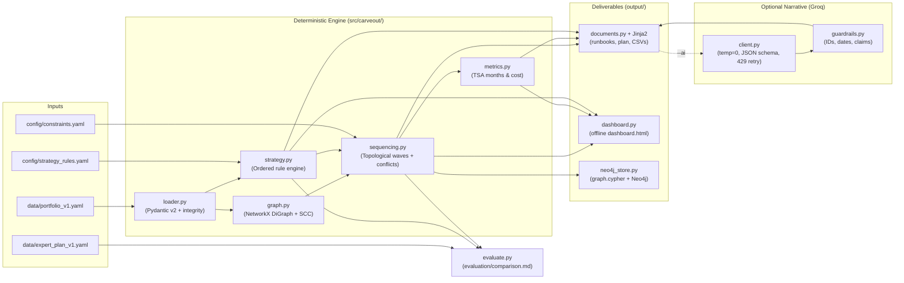
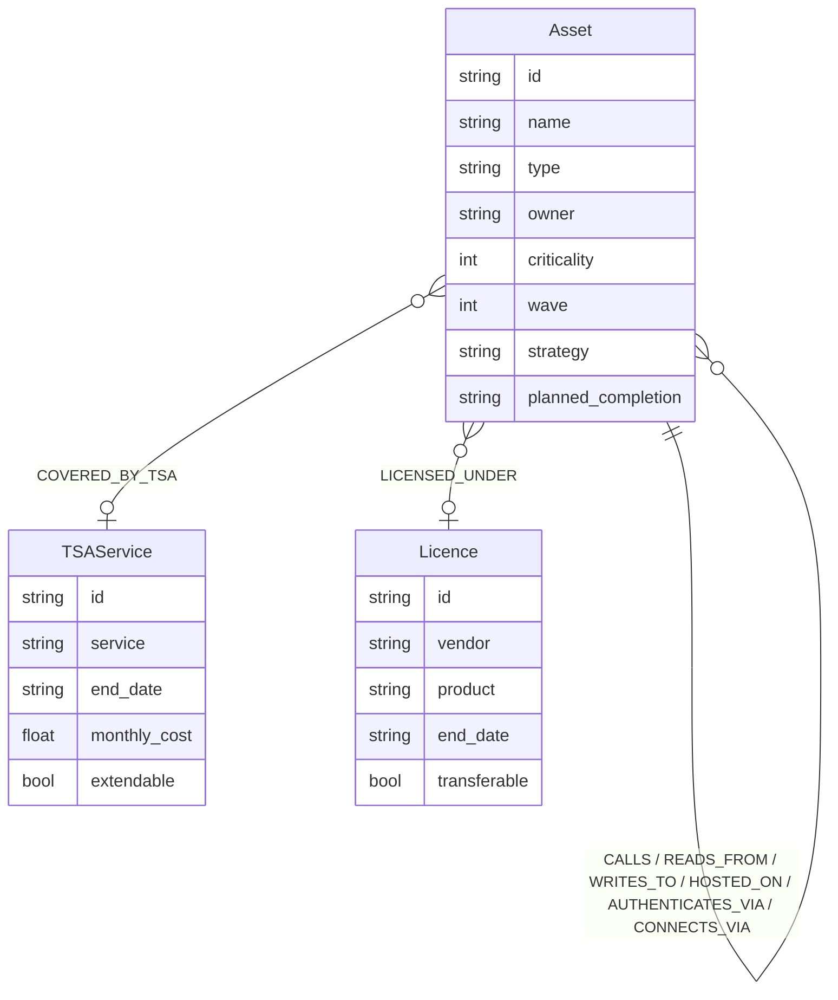

# Carve-out Copilot — System Architecture

> **Core design principle:** **Code decides, AI explains.**  
> All graph analysis, strategy selection, wave sequencing, date calculation, conflict detection, and TSA cost estimation are 100% deterministic. Optional LLM generation (Groq) only wraps pre-computed outputs with human-readable narrative, validated by strict JSON schemas and guardrails.

---

## 1. End-to-End Pipeline Architecture



---

## 2. Wave Sequencing & Scheduling Model (`sequencing.py`)

Each asset `a` has two distinct effort dimensions:
- **`build_effort_weeks`**: parallel preparation starting at `planning.day1`.
- **`effort_weeks`**: cutover duration starting at its wave's `planned_start`.

```
Day 1 (2027-01-04) ──[ build_effort_weeks (parallel) ]──► Build Ready
                                                              │
Cutover Start (2027-03-01) ───────────────────────────────────┼──► Wave N Start = max(
Prev Wave End + gap_weeks ────────────────────────────────────┘      prev_end + gap,
                                                                     cutover_start,
                                                                     max(Build Ready in Wave N)
                                                                   )
Wave N Start ──[ effort_weeks ]──► Asset Planned Completion
```

### Graph Ordering Rules
1. **Standard dependency (`src -> tgt`, `tgt` not `retain_under_tsa`)**: `tgt` is scheduled before `src` (`wave(tgt) <= wave(src)`).
2. **TSA-retained dependency (`src -> tgt`, `tgt` is `retain_under_tsa`)**: edges into `retain_under_tsa` nodes are reversed in `_planning_graph()` so `src` exits **before or with** `tgt` (`wave(src) <= wave(tgt)`), including `retain_under_tsa -> retain_under_tsa` chains.
3. **Cycles (Strongly Connected Components)**: detected via `nx.condensation(graph)` and kept intact in the same wave.
4. **Capacity splitting**: levels exceeding `max_assets_per_wave` are split into consecutive waves without breaking SCCs.
5. **Conflict detection**:
   - `licence_expires_before_cutover` (`asset_completion > licence.end_date`)
   - `tsa_extension_required` (`service.end_date < asset_completion <= extension_end`)
   - `tsa_ends_before_cutover` (`asset_completion > extension_end` or non-extendable)
   - `target_tsa_exit_missed` (`latest_planned_completion > planning.target_tsa_exit`)
   - `cycle_exceeds_wave_capacity`

---

## 3. Neo4j & Cypher Graph Schema (`neo4j_store.py`, `cypher_queries.py`)



- **12 parameterized Cypher queries** in `src/carveout/cypher_queries.py` (`transitive_deps`, `transitive_impact`, `tsa_conflicts`, `licence_conflicts`, `critical_path`, `cycles`, `shared_blockers`, `assets_by_wave`, `tsa_cost_summary`, `sensitive_assets`, `wave_predecessors`, `full_graph`).
- **Offline export**: `carveout neo4j-export` writes `output/graph.cypher` without requiring a running Neo4j server.

---

## 4. LLM Narrative & Guardrails (`generation/`)

When `--ai` is enabled:
1. `client.py` calls Groq with **`temperature=0`**, strict JSON schema (`NarrativeOutput` with `extra="forbid"`), and **429 rate-limit backoff** (`_retry_after_seconds`).
2. `guardrails.py` validates every response before accepting it:
   - Rejects unknown asset IDs, wave numbers, and regex-matched identifiers in prose.
   - Rejects invented ISO dates not present in the computed payload.
   - Rejects ungrounded guarantee claims (`guarantee*`, `uninterrupted`), false wave independence (`independent waves`), misnamed TSAs (`security/service/support agreement`), `re-host*` on waves with `retire` assets, and `final` on non-final waves.
3. Inputs and attempts are logged in `logs/` for deterministic replay.

---

## 5. Evaluation & Quality Assurance (`evaluate.py`, `tests/`)

- **Expert comparison (`carveout evaluate`)**: evaluates strategy match %, pairwise wave order similarity %, theme + asset-ID risk coverage %, dependency violations (both normal and `retain_under_tsa` reversed invariants), and scans all generated `.md` files for hallucinated identifiers.
- **Robustness check**: verifies all scheduling invariants on an unseen portfolio (`data/portfolio_v2.yaml`).
- **Unit & integration suite (`pytest`)**: 25 tests covering schema validation, cycle/capacity/build-effort/TSA-order invariants, document generation, guardrails, dashboard generation, and evaluation.

---

## 6. Module Map

| Module | Responsibility |
|---|---|
| `src/carveout/models.py` | Pydantic v2 domain models (`Portfolio`, `Asset`, `Relationship`, `Licence`, `TSAService`, `Planning`) |
| `src/carveout/loader.py` | YAML parsing, schema validation, integrity warnings |
| `src/carveout/graph.py` | NetworkX `DiGraph`, transitive `dependencies`/`impact`, `cycles`, `graph.html` |
| `src/carveout/strategy.py` | Ordered rule engine (`config/strategy_rules.yaml`) |
| `src/carveout/sequencing.py` | Topological wave planner, parallel build effort, TSA reversal, conflicts |
| `src/carveout/metrics.py` | Longest chain, cycle count, TSA months and cost |
| `src/carveout/dashboard.py` | Self-contained `output/dashboard.html` generator with SVG arrowheads |
| `src/carveout/neo4j_store.py` | Neo4j Bolt loader, Cypher runner, `.cypher` script exporter |
| `src/carveout/cypher_queries.py` | Catalogue of 12 Cypher analytics queries |
| `src/carveout/generation/documents.py` | Jinja2 runbooks, separation plan, risk register & TSA CSVs |
| `src/carveout/generation/client.py` | Optional Groq client (`temperature=0`, strict JSON, 429 retry, log cache) |
| `src/carveout/generation/guardrails.py` | Reference, date, and semantic claim validation |
| `src/carveout/evaluate.py` | Expert comparison, markdown hallucination scan, robustness check |
| `src/carveout/cli.py` | CLI entry point (`carveout <command>`) |
